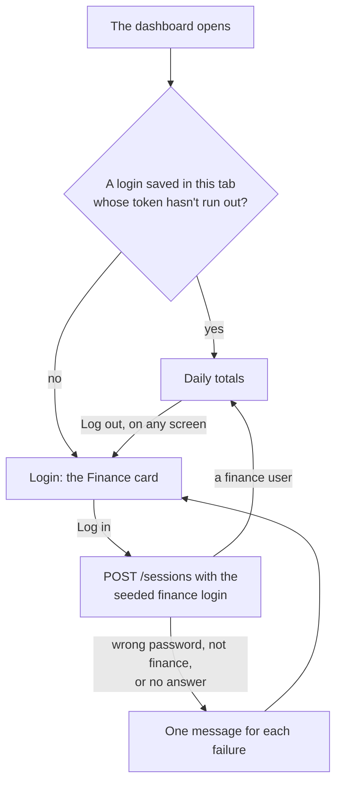
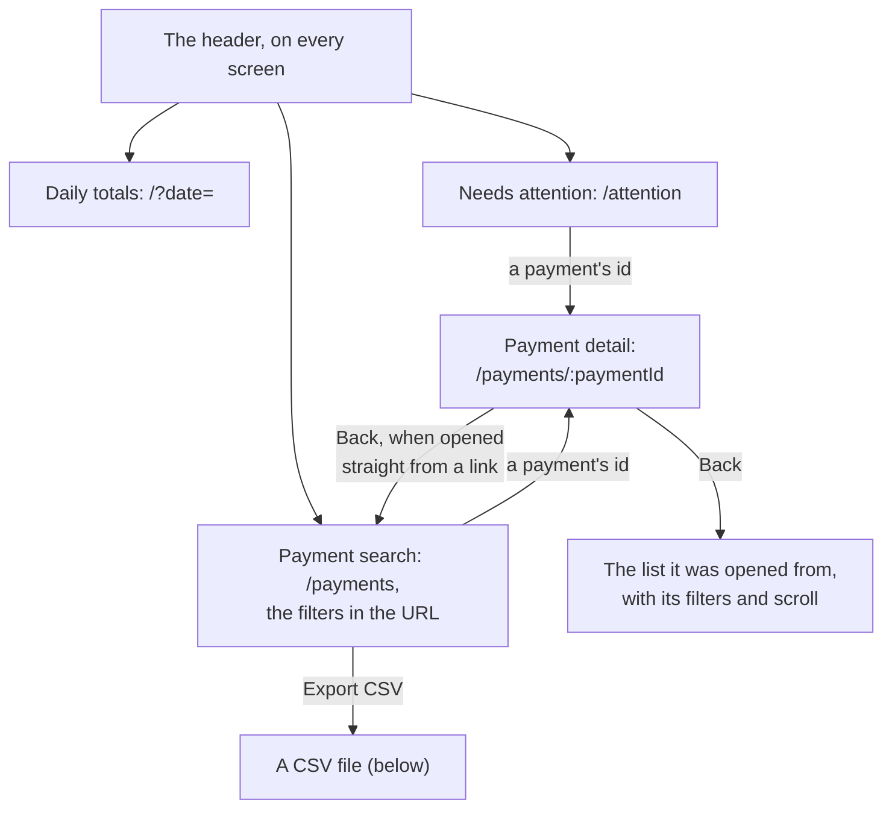
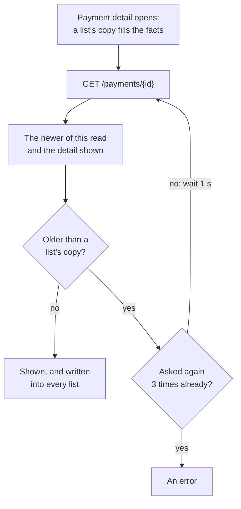
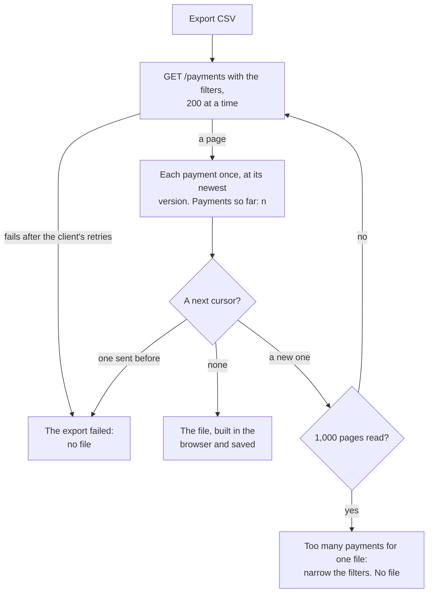

# Dashboard

What the Studierendenwerk dashboard does today, how each part works, and what
is still to build. Progress and commits are in
[plan.md](plan.md#step-4-dashboard). Where the API makes something hard, the
gap is in [api-gaps.md](api-gaps.md).

The dashboard is for the finance team. It is a static web app for a desktop
browser, and it also works at phone width. It is live at
<https://ashish15082001.github.io/zahln/>, deployed by CI from
`version1.0.0` ([plan.md](plan.md#step-5-ship)).

## Features

| Feature           | What finance sees                                                                                                                                                                  | How it works                                                                                                                                                                                                                                                                                |
| ----------------- | ---------------------------------------------------------------------------------------------------------------------------------------------------------------------------------- | ------------------------------------------------------------------------------------------------------------------------------------------------------------------------------------------------------------------------------------------------------------------------------------------- |
| Login             | A card for the seeded Finance user with **Log in**. No form. One message per failure: wrong password, not a finance account, no server                                             | `POST /sessions` with the seeded login from `data/testUsers.ts`. Only `finance` gets in: a cashier's or a payer's token would list only their own payments, so every number would be quietly partial                                                                                        |
| Staying signed in | A reload keeps the login. Closing the tab ends it                                                                                                                                  | The token, its expiry and the user in the tab's `sessionStorage` (`zahln.dashboard.session.v1`), so a shared office computer keeps no token once the tab is closed. The password in memory only, to log in again 30 seconds before the token ends and after a 401, as in both apps          |
| Header            | The app's name, the three sections, the user's name and **Log out**, on every screen                                                                                               | The current section is marked `aria-current="page"`. Log out forgets the token, the password and every cached answer                                                                                                                                                                        |
| Daily totals      | Previous day, the day as a button that opens a calendar, and next day. Five tiles: gross, refunded, net, payments and pending, "not in gross". A table of each mensa and its tills | `GET /reports/daily-totals?date=`. It opens on today in Berlin by the server's clock, and the day is kept in the URL (`?date=`). Today refreshes every 30 seconds while the tab is in front; another day on **Refresh** and when the tab comes back. "Updated" says when the totals arrived |
| Payment search    | A search by the start of a payment, order or payer id. Filters: mensa, till, status and a range of days. A table: created, status, amount, refunded, mensa and till, payer and ids | `GET /payments` with the filters, 50 at a time with **Load more**. The filters live in the URL, so a reload, Back and a shared link show the same list. Each filter applies as it changes; the search when it is sent. A range of days is applied with **Apply**                            |
| Payment detail    | Why it needs attention, the amount and status, the facts, the items, the refunds and the history, oldest first                                                                     | `GET /payments/{id}` at `/payments/:paymentId`, opened from the payment's id in a table. A list's copy fills the facts and items while the refunds and history load. Focus moves to the heading, and **Back** returns to the list with its filters                                          |
| Needs attention   | The payments the server has flagged, with a badge for each reason beside the status. "Nothing needs attention" when there are none                                                 | `GET /payments?needsAttention=true`, in the search's table with a Reasons column                                                                                                                                                                                                            |
| CSV export        | **Export CSV** above the search's table, a line counting the payments so far, then the name of the file saved                                                                      | Pages through `GET /payments` with the current filters, 200 at a time, and builds the file in the browser ([below](#the-csv-file))                                                                                                                                                          |
| Screens           | One column up to 1280 px wide. A table wider than the screen scrolls sideways inside its box. Text stays selectable, so ids can be copied                                          | `ScreenLayoutJSX` from `packages/ui` with its `7xl` column, and the shared header in its header slot, where the apps put their own headers                                                                                                                                                  |
| Languages         | English or German, from the browser                                                                                                                                                | i18next. Amounts, counts, days and times through `Intl`, times on Berlin's clock                                                                                                                                                                                                            |
| Access            | A visible label above every filter, a search landmark, tables with column and row headers, and every status and reason as an icon and a word                                       | The days button is named by its label and its value, "Days, Mon, Oct 19, 2026 – Tue, Oct 20, 2026". Loading, errors and the export's progress are in live regions                                                                                                                           |

## Logging in

Only `finance` gets in. Any other account logs in at the server, but the
dashboard doesn't keep its token. A login saved in this tab whose token hasn't
run out skips the login screen.

## Finding a payment

Every screen keeps what it shows in the URL, so a reload, Back and a shared
link open the same view.

## Days on Berlin time

The server counts days in Europe/Berlin: the daily totals' `date`, and the day
a payment was made. The dashboard counts them the same way everywhere.

- **Today** is the Berlin day of the server's clock, taken from each reply's
  `Date` header, not of the laptop's clock.
- **A day is a `YYYY-MM-DD` string,** in the URL and in the code. Not a
  `Date`: which day a moment falls on depends on the time zone it is read in.
- **A range of days** becomes two moments with Berlin's offset on that day:
  `from` is the first day's midnight, and `to` the midnight after the last
  day, since the server's `to` means "created before". 20 Oct 2026 starts at
  `+02:00` and 26 Oct at `+01:00`. The offset is read at 00:00 UTC, which is
  already that day in Berlin and before the clocks change at 02:00 or 03:00.
- **Stepping a day** is done in UTC, so the night the clocks change never
  skips or repeats a day.

It is all in `packages/domain/src/day/berlinDay.ts`, tested on the nights the
clocks change.

## Keeping the numbers true

- **Each day's totals are their own entry.** After picking another day, the
  tiles show placeholders until that day's totals arrive, never the last
  day's numbers under the new date. An answer for another day than the one
  asked for is refused.
- **Each set of filters has its own list,** for the same reason.
- **Late answers never win.** A payment never goes back to a lower `version`
  than one a list showed. The detail is checked against every list: a read
  older than a list's copy is asked again, up to 3 times, 1 second apart, and
  a newer one is written into every list, so Back never shows an older
  status.
- **A failed refresh keeps what was shown,** with a note that it may be out of
  date.
- **Pending is never in gross.** It has its own tile and column.
- **The daily totals carry no `version`,** so an out-of-date answer can't be
  told apart from a fresh one
  ([API gap 9](api-gaps.md#9-daily-totals-have-no-version)). Today's are read
  again every 30 seconds, with the time they arrived on screen.

How the payment detail checks a read against the lists:

## The CSV file

The columns, agreed before the step: payment ID, order ID, created (Berlin
time), status, amount, refunded, refund on its way, price group, mensa, till,
payer ID, and the reasons it needs attention.

- **All or nothing.** Every page the filters match, 200 at a time, the most
  the server gives. A page that still fails after the client's retries fails
  the export: no file, and an alert. A file never holds part of the payments
  while looking whole.
- **Each payment once,** at its newest version, when a new payment pushes one
  onto the next page.
- **No endless export.** A cursor the server has sent before stops it, and so
  do more than 1,000 pages (200,000 payments), with a message to narrow the
  filters.
- **No formulas.** A cell starting with `=`, `+`, `-`, `@`, a tab or a
  carriage return gets a leading `'`, so a spreadsheet shows it as text. A
  cell with the separator, a quote or a line break is quoted, as RFC 4180
  says, and lines end in CRLF.
- **Written for a spreadsheet in the app language.** In German, `;` between
  cells and `5,60`; in English, `,` and `5.60`. Each opens in Excel in that
  language without an import step. Times are `2026-10-20 13:57:10` in Berlin
  time, which Excel reads as a date, and a UTF-8 byte order mark makes it
  show umlauts as they are. The headers, statuses, price groups and reasons
  are in the app language too.
- **Named after the day it was saved,** e.g. `zahln-payments-2026-11-02.csv`.

Checked against the daily totals: the confirmed payments at Mensa Nord on
20 Oct 2026 export as 78 rows, the report's count for that mensa and day.

## How it is built

| Layer   | Where                                                             | What it holds                                                                                                                                                                                                                                                                                                                                                          |
| ------- | ----------------------------------------------------------------- | ---------------------------------------------------------------------------------------------------------------------------------------------------------------------------------------------------------------------------------------------------------------------------------------------------------------------------------------------------------------------- |
| Screens | `apps/dashboard/src/screens/`                                     | As in both apps: every part is `Foo.tsx` (data, handlers and what it works out) and `FooJSX.tsx` (markup only), and a parent always renders `Foo`. A screen is `paymentDetailScreen/` with `PaymentDetailScreen.tsx` and `PaymentDetailScreenJSX.tsx`, its content in `paymentDetailContent/` handed to `ScreenLayoutJSX`, and the parts only it uses in `components/` |
| Shared  | `apps/dashboard/src/components/`                                  | The header, the title row with Refresh, the payment list with its states, the payment table with a component per cell, the data table, and the status badge for payments and refunds                                                                                                                                                                                   |
| Data    | `apps/dashboard/src/data/`                                        | The seeded finance user, and TanStack Query hooks: `useDashboardSession`, `useLogin`, `useDailyTotals`, `useMensas`, `useFinancePayments`, `useAttentionPayments`, `useFinancePayment` and `usePaymentsExport`. Screens never call the API                                                                                                                             |
| Routes  | `apps/dashboard/src/app/`                                         | `/login`, `/` for the daily totals, `/attention`, `/payments` and `/payments/:paymentId`, behind the same signed-in and signed-out guards as the apps. An unknown path goes to `/`                                                                                                                                                                                     |
| Shared  | `packages/api`, `packages/domain`, `packages/ui`, `packages/i18n` | The client and the token renewal; the finance user, daily totals, finance payment, Berlin days and the CSV writer; shadcn's `Calendar` and `Popover`; the strings and the money, count and day formats. All shared with the apps                                                                                                                                       |
| Tests   | `apps/dashboard/src/tests/` and each package                      | The CSV's rows here. In the packages: Berlin days, the CSV writer, the daily totals and finance payment shapes, and every request the dashboard makes                                                                                                                                                                                                                  |

## Still to build

- **How many payments match.** The server sends no total, so the search shows
  how many it has loaded ([API gap 10](api-gaps.md#10-no-total-and-no-snapshot-when-paging-payments)).
- **Renewing after a reload.** The password is only in memory, so a reloaded
  tab can't renew its token and logs out when it runs out
  ([API gap 2](api-gaps.md#2-no-refresh-token)).
- **Filters on Needs attention,** at least by mensa, which the server can
  already filter by.
- **Loading screens on demand.** The build is one JavaScript file of about
  830 kB, which a desktop on the campus network takes in its stride, but each
  screen could load when first opened.
