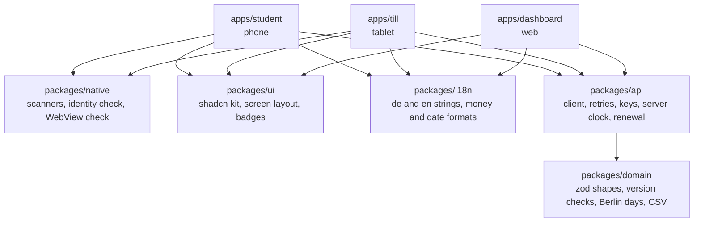
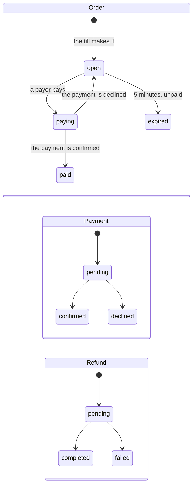
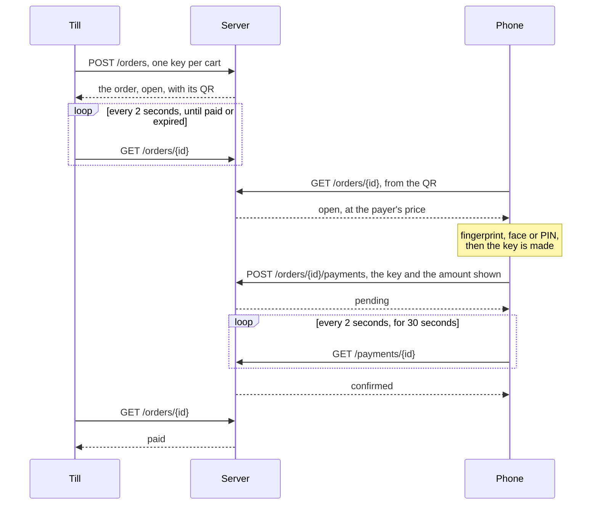

# Design document

## Architecture and what is shared

Three surfaces in one TypeScript monorepo. Each app has two layers, screens
and data, and everything under the data layer is shared.

| Layer   | Where                 | What it holds, and the rule it keeps                                                                                                                                                                                                                                           |
| ------- | --------------------- | ------------------------------------------------------------------------------------------------------------------------------------------------------------------------------------------------------------------------------------------------------------------------------ |
| Screens | `apps/*/src/screens/` | Every part is a container, `Foo.tsx`, which works out what to show, and its markup, `FooJSX.tsx`, which only draws it. No screen calls the API. Each screen's code loads the first time it opens, so a start parses only what it shows                                         |
| Data    | `apps/*/src/data/`    | TanStack Query hooks, one per resource, and the login as one session object outside React. State the server doesn't have, such as the till's cart, stays in the screen that owns it                                                                                            |
| Client  | `packages/api`        | A 10 second deadline per attempt and up to 3 attempts with backoff, only for a lost reply or an error the server marks `retryable`, always with the same `Idempotency-Key`. Server time from the `Date` header, one typed set of errors, the token renewal and the saved login |
| Shapes  | `packages/domain`     | A zod schema for every response, checked at the boundary, split into the server's shape (`backend.ts`) and the app's (`frontend.ts`). The pure rules: which copy of a payment is newer, whether an order can be paid, Berlin days, the CSV writer. No React, no DOM, tested    |
| UI kit  | `packages/ui`         | shadcn components as generated, and the parts every screen shares: the screen layout, the status badge, the date and time, Refresh, and the screen that shows when a screen can't open                                                                                         |
| Strings | `packages/i18n`       | `en.ts` holds the keys and `de.ts` is typed against it, so a German string that is missing fails the typecheck                                                                                                                                                                 |
| Native  | `packages/native`     | Capacitor plugins behind small tested wrappers, so no screen touches a plugin, and the WebView check both Android apps run first                                                                                                                                               |

What differs between the apps is who may log in (a payer, a cashier with a
till, or finance), where the login is kept (the apps' `localStorage`, the
dashboard's tab), and the screens. The rules that keep money right live once,
in `api` and `domain`, and are tested without React. Packages export their
source, and each app's Vite build compiles it, so there is no package build
step.

## How a payment moves through its states

The server owns every state. The apps only show what it last said, and a
copy with a lower `version` never replaces a higher one.

One payment, from the till to the phone and back:

When something goes wrong, each side does this:

| What goes wrong                                | The phone                                                                                                                                                                                                           | The till                                                                                     |
| ---------------------------------------------- | ------------------------------------------------------------------------------------------------------------------------------------------------------------------------------------------------------------------- | -------------------------------------------------------------------------------------------- |
| The reply to a POST is lost: 502, 504 or none  | "Payment not confirmed. It may have gone through", and **Check again** with the same key. The server hands back the payment it has, never a second one                                                              | "Couldn't confirm the order", and **Try again** with the same key while the cart is the same |
| `503 unavailable`                              | Sent again up to 3 times with the same key, then as above                                                                                                                                                           | The same                                                                                     |
| The token runs out: 401                        | Logs in again with the password kept in memory, and sends the same request with the same key. The payer sees nothing                                                                                                | The same, and the QR dialog stays open                                                       |
| A read comes back older than one shown         | Dropped. Paid is final                                                                                                                                                                                              | Dropped                                                                                      |
| The payment stays pending for minutes          | After 30 seconds, "Still being checked" and **Refresh**. Never "nothing was paid" while it may still go through                                                                                                     | "Payment being checked…" until the order says paid or expired                                |
| The countdown reaches 0                        | Pay turns off. Only the server says expired, and a payment sent just before is still decided by it                                                                                                                  | The dialog stays until the server says expired                                               |
| The device's clock is wrong                    | The countdown and the token's expiry run on the server's clock                                                                                                                                                      | The same                                                                                     |
| The app is closed mid-payment                  | The key goes with it. Scanning again shows the payer's payment. Pay asks again and sends a new key, which the server refuses while the first payment is pending or paid                                             | The open order isn't kept across a restart ([README](../README.md#what-i-left-out-and-why))  |
| The price changed: `409 amount_mismatch`       | The order is read again, and Pay shows the new amount, with a new key                                                                                                                                               |                                                                                              |
| Payments are paused, or the app is too old     | Before the tap, from `GET /config`: Pay off with "Payments are paused", or an Update Zahln screen in place of every screen. If the server says it first, `503 payments_disabled` or `426`, the config is read again |                                                                                              |
| Another payer is paying the order, or has paid | "A payment for this order is being checked" or "Already paid", and **Done**                                                                                                                                         | Shows the order's state as the server gives it                                               |

The details, with every answer to Pay, are in
[student-plan.md](student-plan.md#paying) and
[till-plan.md](till-plan.md#the-order-dialog). Refunds aren't on the till yet;
the dashboard shows each refund's state.

## Shipping releases for an app that cannot be hotfixed

An APK stays on a phone as it is until its owner updates it. So each version
has to be safe on its own, and the server has to be able to stop an old one.

What is built:

| Lever                           | How it works                                                                                                                                                                                                                                                                                                                                                      |
| ------------------------------- | ----------------------------------------------------------------------------------------------------------------------------------------------------------------------------------------------------------------------------------------------------------------------------------------------------------------------------------------------------------------- |
| A minimum app version           | Every request carries `X-App-Version` from the app's `package.json`. The student app reads `GET /config` at start, when it comes back to the front and before each new payment: below `minAppVersion`, an Update Zahln screen takes the place of every screen, with a link to the latest release. The server also refuses a payment from such a version with 426  |
| Switching payments off          | `GET /config` turns the student app's Pay off before the tap, and the Pay page asks again every 30 seconds, so Pay comes back by itself. A tap reads it first and stops before the fingerprint check. The server's `503 payments_disabled` says "Payments are paused. Try again in a few minutes" too, and the key is kept when the server says it may pass later |
| A WebView too old for the app   | A plain script checks before the app starts and shows what to update ([plan.md](plan.md#step-5-ship))                                                                                                                                                                                                                                                             |
| Saved data from another version | Every key the apps save under has a version in its name, such as `zahln.app.session.v1`, and what is read back is checked by zod. A new shape gets a new key, so an older version's data is never read as the new shape, and a broken save counts as none                                                                                                         |
| Values a newer server sends     | An unknown history event reads "Other change" and an unknown attention reason "Other reason", instead of failing the screen                                                                                                                                                                                                                                       |
| Signed releases                 | CI signs both APKs with one release key and fails unless each carries its certificate, so an update always installs over the version before                                                                                                                                                                                                                       |
| The dashboard                   | A static site on Vercel, deployed by CI once every check passes: the next push is live for everyone, with nothing to update                                                                                                                                                                                                                                       |

What I would add before a real release:

- **A staged rollout on Google Play,** for example to 5%, 20% and 50% of
  phones over a few days before everyone, halted when crashes or failed
  payments rise. `minAppVersion` would go up only after that, and never past a
  version most phones already have.
- **Crash reporting and a failed-payment rate per app version,** to decide
  when to halt ([below](#crash-reporting)).
- **A `versionCode` from CI,** such as the run number. It is fixed at 1, so a
  second release would first need it raised.
- **A server that keeps answering every version above `minAppVersion`,**
  since some phones update weeks late.

### Crash reporting

Optional in the brief, and not built. How I would add it:

| Part                    | How                                                                                                                                                                                                                                                                                                                   |
| ----------------------- | --------------------------------------------------------------------------------------------------------------------------------------------------------------------------------------------------------------------------------------------------------------------------------------------------------------------- |
| The tool                | Sentry, in its EU region. `@sentry/capacitor` with `@sentry/react` in the student app and the till, which reports JavaScript errors and native crashes in one place, and `@sentry/react` in the dashboard                                                                                                             |
| Where it starts         | `Sentry.init` in each app's `main.tsx`, before the first render. The release is the version from `package.json`, the same one the app sends as `X-App-Version`, so every report and every rollout stage name the same version                                                                                         |
| Errors the router keeps | A screen that throws, or whose file fails to load, ends on the Reload screen, and React Router doesn't pass the error on. `RouteErrorScreen` reports what `useRouteError` gives it                                                                                                                                    |
| No personal data        | `sendDefaultPii` off, no user attached and no session replay. `beforeSend` and `beforeBreadcrumb` drop the `Authorization` header, request bodies and query strings. Screens are named by their route, `/pay/:orderId`, never by the address with the id in it. A report says which screen and which version, not who |
| Readable stacks         | Vite builds with hidden source maps. CI uploads them to Sentry with a `SENTRY_AUTH_TOKEN` secret, and they never go into an APK or onto the site                                                                                                                                                                      |
| Failed payments         | Besides crashes, one event for each Pay that ends without a result: "Payment not confirmed" after 3 tries, or a refusal, tagged with the version and the server's error code and nothing else. With crash-free sessions per version, that rate is what a staged rollout halts on                                      |
| Consent                 | The reports carry no personal data. Whether they still need the payer's consent is a question for Zahln's data protection officer; if so, Sentry starts only after a yes                                                                                                                                              |

## Security and data protection on the device

What each surface keeps, and where:

| What                                        | Kept in                                                                                  | Why it is kept, and what limits it                                                                                                |
| ------------------------------------------- | ---------------------------------------------------------------------------------------- | --------------------------------------------------------------------------------------------------------------------------------- |
| The token, its expiry and who is logged in  | The apps' `localStorage`, in their own WebView. The dashboard's tab, in `sessionStorage` | So a reopen or a reload skips the login. A token lasts 5 minutes, and one that has run out or doesn't match its schema is dropped |
| The password                                | Memory only                                                                              | To log in again when the token runs out. Never written to the device, so a reopen forgets it                                      |
| The pay key: the order, the amount, the key | Memory only                                                                              | So a lost reply is resent with the same key while the app runs. Spent once a payment comes back, and forgotten on Log out         |
| Payments and orders from the server         | Memory only, in TanStack Query's cache                                                   | Log out clears it, so the next person on the device sees nothing of the last                                                      |
| The release key                             | GitHub secrets                                                                           | Never in the repo; a copy is kept offline. CI writes it to the job's temp folder for the build                                    |
| The candidate ID                            | Every build, and readable in the dashboard's public JavaScript                           | A page that calls the API from the browser has to carry it, and it reaches sandbox data only                                      |

The checks:

- **The phone's owner confirms every new payment** with a fingerprint, the
  face or the phone's PIN, in Android's own dialog, which shows the amount
  and the mensa.
- **Only the server's answer moves money,** and every answer is checked
  against its schema before anything shows it.
- **No server text is shown as HTML.** React escapes it, the WebView check
  sets text only, and a CSV cell that would run as a spreadsheet formula is
  written as text.
- **The apps load only their own files.** Live reload from a laptop
  (`CAP_DEV_URL`) is for development, and CI never sets it.
- **Log out forgets the token, the password and the cache.** The server
  still accepts the token until it runs out, since the API has no log out
  ([API gap 3](api-gaps.md#3-no-log-out)).
- **Nothing is backed up or moved to a new phone.** Both apps set
  `allowBackup="false"`, and `dataExtractionRules` exclude every folder from
  the cloud backup and from a transfer to a new device on Android 12 and
  later, so the saved login stays on the device it was made on.

Not done yet:

- **The saved login is plain `localStorage`.** On a rooted phone it can be
  read. For a token of 5 minutes that is a small window; a refresh token
  ([API gap 2](api-gaps.md#2-no-refresh-token)) would belong in the Android
  Keystore.
- **Payment screens can be captured.** The Pay page doesn't set
  `FLAG_SECURE`, so screenshots and the recent-apps preview show it.

On data protection: the apps keep nothing about a person beyond the name and
ids the server sends. There are no analytics and no tracking, and nothing
leaves the device but the calls to the API.

## Technology choices, and what I would change about yours

The decisions behind the stack, and where they cost something:

- **Capacitor instead of React Native with Expo.** Cleared with Zahln before
  starting. All three surfaces render the same DOM, so UI components are shared
  as well as types and the API client, and TalkBack works with semantic HTML.
  The cost is WebView performance on a low-end Android phone.
- **TypeScript 6.0, not 7.** typescript-eslint supports TypeScript below 6.1,
  and type-aware lint rules such as `no-floating-promises` catch an un-awaited
  payment call.
- **ESLint 9, not 10.** eslint-plugin-jsx-a11y does not yet support ESLint 10,
  and accessibility lint matters for the screen-reader requirement.
- **Flat `node_modules` (`nodeLinker: hoisted`).** Capacitor's Gradle files
  reach native plugins through `node_modules` paths.
- **`@capgo/capacitor-native-biometric` for the check before Pay.** It is
  free on public npm, supports Capacitor 8, is kept up to date, and can also
  keep secrets in the Android Keystore, which the till's re-login will need.
  Capawesome's Biometrics plugin has a nicer API but needs a paid licence and
  a private npm registry, so a clone of the repo wouldn't install without one.
  `@aparajita/capacitor-biometric-auth` can't store secrets. Two of the
  plugin's Android defaults are worked around in `packages/native`: the PIN
  is offered only when `DEVICE_CREDENTIAL` is in `allowedBiometryTypes` (its
  `useFallback` option is ignored there), and `maxAttempts` is raised from 1
  to Android's maximum of 5, or one misread finger would end the check.
- **A sticky header and footer, with the window scrolling.** Both apps build
  every screen on `ScreenLayoutJSX` in `packages/ui`. Scrolling only the
  content between a fixed header and footer was ruled out: React Router
  restores only the window's scroll, so Back from a payment would land at the
  top of the list. Sticky, not fixed, so a footer that grows, such as Pay
  with a message above it, never covers the end of the content. The header
  pads by the status bar and the footer by the nav bar, so the page is the
  screen's height and their background covers content scrolling under the
  bars.
- **Till orientation.** The till is locked to landscape, but Android 16 ignores
  that lock on tablets for apps targeting API 36, so its layout must also work
  in portrait.
- **The dashboard keeps its login for the tab only.** `sessionStorage`, not
  `localStorage`: a reload keeps the login, and closing the tab on a shared
  office computer leaves no token behind. The password stays in memory, as in
  the apps, so a reloaded tab logs out when its token runs out.
- **The dashboard's CSV follows the app language.** Semicolons and decimal
  commas in German, commas and decimal points in English, so a file opens in
  Excel in that language without an import step. The cost: the same payments
  give different files in the two languages. A fixed format for other tools
  would be an option on the export.

## What the API is missing, and what I would change

See [api-gaps.md](api-gaps.md).
