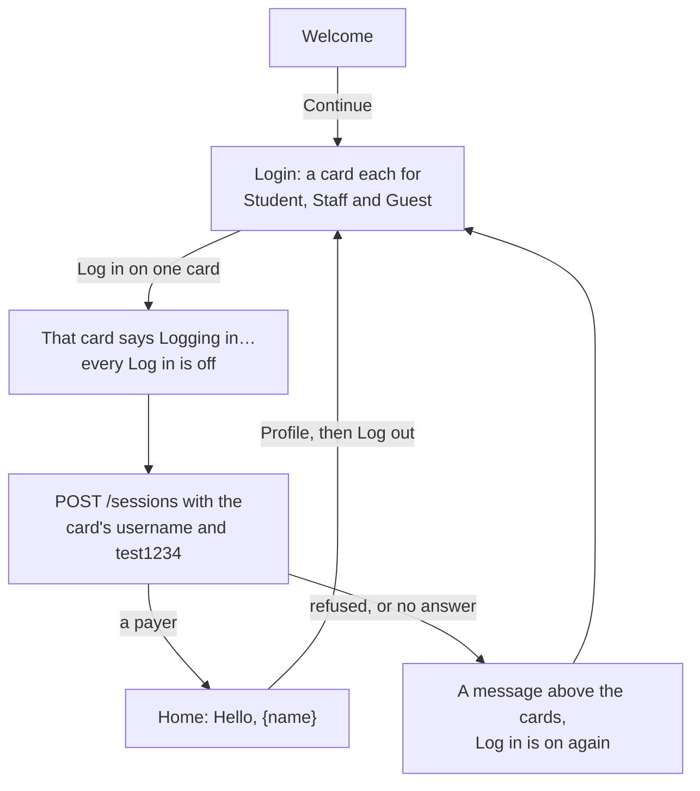
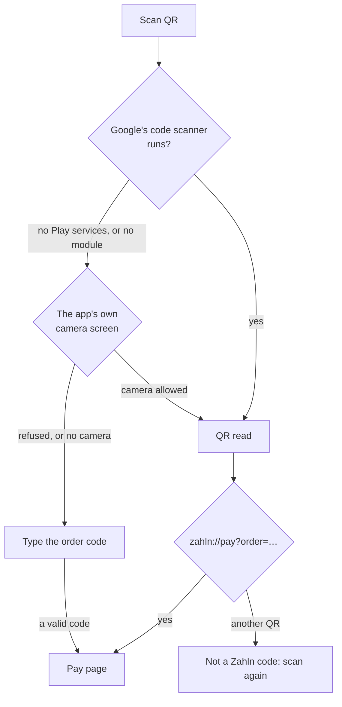
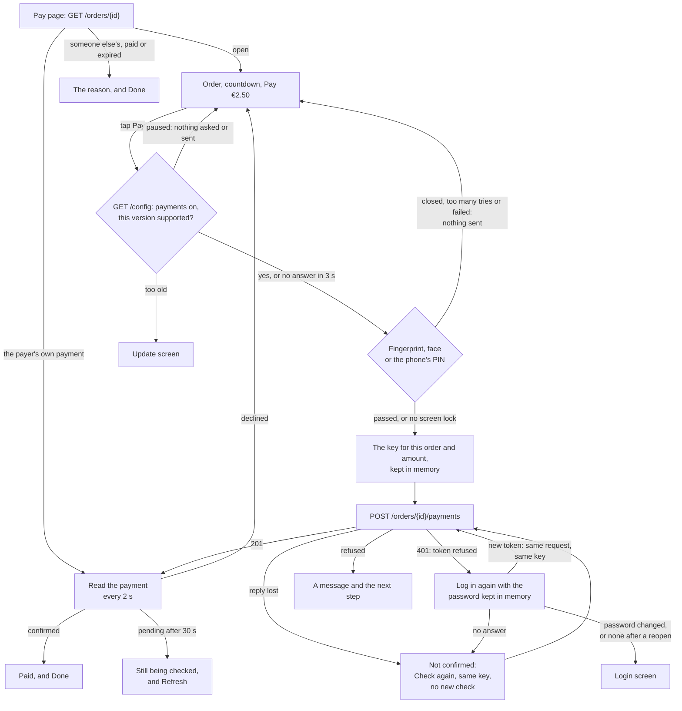

# Student app

What the student app does today, how each part works, and what is still to
build. Progress and commits are in [plan.md](plan.md#step-3-student-app).
Where the API makes something hard, the gap is in [api-gaps.md](api-gaps.md).

The app is for payers: students, staff and guests. It runs on Android phones,
low-end ones included.

## Features

| Feature             | What the payer sees                                                                                                                                                                                                                                                                                                | How it works                                                                                                                                                                                                                                                                                                                                                                                                                      |
| ------------------- | ------------------------------------------------------------------------------------------------------------------------------------------------------------------------------------------------------------------------------------------------------------------------------------------------------------------ | --------------------------------------------------------------------------------------------------------------------------------------------------------------------------------------------------------------------------------------------------------------------------------------------------------------------------------------------------------------------------------------------------------------------------------- |
| Welcome and login   | **Continue**, then a card for each test user: Student, Staff and Guest, each with the prices they pay and **Log in**. No username or password to type. One message per failure                                                                                                                                     | `POST /sessions` with the card's seeded login, from `data/testUsers.ts`. Only a payer gets in: `student`, `staff` or `guest` ([below](#logging-in))                                                                                                                                                                                                                                                                               |
| Update required     | When the server needs a newer app, an **Update Zahln** screen takes the place of every screen, Login included, with **Download the update**                                                                                                                                                                        | `GET /config`, with no login, at start and each time the app comes back to the front ([below](#the-servers-config))                                                                                                                                                                                                                                                                                                               |
| Staying signed in   | A quick reopen skips the login screen. While the app stays open, the session doesn't run out, even in the middle of a payment                                                                                                                                                                                      | The token, its expiry and the payer are saved in `localStorage` (`zahln.app.session.v1`) and restored before the first render. The password is kept in memory only, to log in again before the token ends ([below](#renewing-the-token))                                                                                                                                                                                          |
| Payment history     | Home lists the payer's payments, newest first, one full-width row each: mensa, amount, date, status and any refund. The dishes are on the payment's detail                                                                                                                                                         | `GET /payments`, 20 at a time with **Load more**. Fetched when Home opens, when the app comes back to the front and with **Refresh**. No polling: a payment can stay pending for days. Each row is shadcn's `Item`, as a link                                                                                                                                                                                                     |
| Payment detail      | Amount, mensa and till, items and total, the refunds, and the history from start to now                                                                                                                                                                                                                            | `GET /payments/{id}` at `/payments/:paymentId`. The list's copy shows at once while the rest loads. Focus moves to the heading, and Back returns to the same place in the list                                                                                                                                                                                                                                                    |
| Scan QR             | A **Scan QR** button that stays at the bottom of Home. A scan opens the Pay page                                                                                                                                                                                                                                   | Google's code scanner first, then two fallbacks ([below](#scanning))                                                                                                                                                                                                                                                                                                                                                              |
| Pay page            | The mensa, the till, the items and the price for the payer's group, with "Pay within 4:32" and **Pay €2.50**. While payments are paused, the page says so and Pay is off                                                                                                                                           | `GET /orders/{id}` at `/pay/:orderId`. The countdown runs on the server's clock. At 0, Pay turns off and the page asks every 3 seconds until the server says expired or paid. The config is read when the page opens, and every 30 seconds while payments are paused                                                                                                                                                              |
| Confirming it's you | Before anything is sent, Android's own dialog asks for a fingerprint, the face or the phone's PIN, and shows the amount and the mensa                                                                                                                                                                              | `@capgo/capacitor-native-biometric` behind `identityCheck` in `packages/native`. A phone without a screen lock pays without it ([below](#confirming-its-the-payer))                                                                                                                                                                                                                                                               |
| Paying              | **Confirming…**, **Paying…**, then "Payment being checked", "Paid" or "Payment declined", or a message with the next step                                                                                                                                                                                          | `POST /orders/{id}/payments` with one idempotency key per order and amount, saved before the first send. The payment is then read every 2 seconds for 30 seconds ([below](#paying))                                                                                                                                                                                                                                               |
| Order page          | The same order details, read only, with no Pay                                                                                                                                                                                                                                                                     | `/orders/:orderId`. Nothing links to it yet                                                                                                                                                                                                                                                                                                                                                                                       |
| Screens             | Back and the title stay at the top, and Scan QR, Pay and a payment's result buttons stay at the bottom, however far the page scrolls. Two buttons in a footer sit side by side at the same width, the main one on the right. A page is never taller than the screen, and fills its width on a tablet as on a phone | `ScreenLayoutJSX` from `packages/ui`, with its `full` column and a sticky header and footer. The window scrolls, so Back returns to the same place in the list. The title sits under Back, with Refresh at Back's right where a screen has it                                                                                                                                                                                     |
| Profile             | A person icon at the top of Home opens Profile: the name's first letter as an avatar, the full name and which prices the payer pays. Under it, App theme and App language, each with a select, and Log out. The two selects show the choice but don't change the app yet                                           | `/profile`, signed in only. The rows are shadcn's `Item` in an `ItemGroup`, each a list item. Log out forgets the token, the saved login, the password and the cache, and the login screen follows. Focus moves to the title, and Back works like the payment detail's                                                                                                                                                            |
| Languages           | English or German, from the device                                                                                                                                                                                                                                                                                 | i18next. Amounts and times through `Intl`, times on Berlin's clock, the mensas' own time zone                                                                                                                                                                                                                                                                                                                                     |
| Touch and TalkBack  | Buttons and fields at least 48 px tall. Statuses as a solid badge with an icon and a word. Refresh is an icon that turns while it works. Every date and time has a calendar icon. A long press selects no text, except in fields and the Payment ID                                                                | Results and errors are announced. The countdown is a timer region, so TalkBack doesn't read every second. Focus moves to each payment result as it comes in. Refresh is named "Refresh" for TalkBack, and the calendar icon is skipped. A select on Profile is named by its row, "App theme, Same as phone", and Deutsch and English are said in their own language. Each Log in button is named with its card, "Log in, Student" |

## Logging in

The server has three payers, one per price group, all with the password
`test1234` from the API's docs. So the login screen has no form: a card for
each payer, and one tap logs in as them.

- **The same order, three amounts.** `GET /orders/{id}` answers with the
  amount for the logged-in payer's group, and the Pay page names the group
  under the price. To see all three: log in, scan the till's QR, then Log
  out on Profile, pick the next card and scan again.
- **The next payer sees nothing of the last.** Log out clears every answer
  fetched, so an order read before never shows the last payer's amount.
- **One list holds the three:** `data/testUsers.ts`, with each username, the
  password and the price group. A tap runs the same `useLogin` as the form
  did, so the password is kept in memory for
  [token renewal](#renewing-the-token) as before.
- **Only one login at a time.** Every Log in turns off while one is on its
  way, so a second tap can't start a second login.

## Scanning

A phone that can't scan must still get the payer to their order, and typing
the long code is the last resort.

- **Google's code scanner** needs no camera permission and is light on a
  low-end phone. Its module is installed on first use, with a 60 s limit.
- **The app's own camera screen** asks for the camera, and shows "Point the
  camera at the QR code on the till's screen". A QR that isn't the till's gets
  a hint, and scanning carries on.
- **Typing** is offered only when no scanner can run, or the camera is
  refused. The till prints the code under its QR. Spaces are ignored, and the
  QR's whole text can be pasted ([API gap 8](api-gaps.md#8-no-short-order-code)).

## The server's config

`GET /config` needs no login and says two things: the oldest app version the
server still takes, and whether payments are on. The app reads it when it
starts, each time it comes back to the front, when the Pay page opens, and
right before a new payment. No screen waits for it.

| The config says                             | The app                                                                                                                                                                                                                                                                                                                                                           |
| ------------------------------------------- | ----------------------------------------------------------------------------------------------------------------------------------------------------------------------------------------------------------------------------------------------------------------------------------------------------------------------------------------------------------------- |
| This app's version is below `minAppVersion` | An **Update Zahln** screen takes the place of every screen, Login included: "This version can't pay any more", the version it has and the one it needs, and **Download the update**, which opens the latest GitHub release in the phone's browser. Focus moves to its heading. The address stays, so if the minimum comes back down, the payer is where they were |
| `paymentsEnabled: false`                    | The Pay page says "Payments are paused. Try again in a few minutes" above **Pay**, and Pay is off. The page asks again every 30 seconds, so Pay comes back by itself                                                                                                                                                                                              |
| Nothing yet, or it can't be read            | Nothing changes. The server still refuses a payment from an old version with 426, and one while payments are paused with 503                                                                                                                                                                                                                                      |

Before a new payment:

- **Read afresh, before the fingerprint, face or PIN check,** so the payer
  isn't asked to confirm a payment that can't go ahead. Paused or too old,
  it stops there: no check, no key, nothing sent. **Confirming…** covers the
  read.
- **At most 3 seconds.** A slower read, or one that fails, lets Pay go
  ahead, and the server decides. A slow server must not hold the payer at
  the button.
- **Check again isn't stopped.** It only asks about a payment that may
  already exist, under its key.
- **A 426 or `payments_disabled` answer reads the config again,** so the
  update screen or the paused state shows at once.

The decisions behind it:

- **A `minAppVersion` the app can't read counts as supported,** e.g.
  `1.x`. A typo on the server must not lock every payer out, and the server
  still refuses old versions. Versions compare number by number, so
  `1.10.0` is newer than `1.9.0`.
- **A version too old blocks every screen, not only Pay.** The spec says an
  older version must ask the user to update, and an old version may also
  misread what a newer server sends.
- **The link goes to the GitHub release,** since the app isn't on Google
  Play. Capacitor hands a link to another site to the phone's browser.
- **Log out keeps the config.** It isn't the payer's, unlike the rest of the
  cache.
- **The student app only.** The till doesn't pay.

## Paying

Everything about paying happens on the Pay page, and every state there has a
next step. **Back** and **Done** go to Home in place of the Pay page, so Back
never returns to an order that is already paid. Before anything is sent,
the phone checks that its owner is paying
([below](#confirming-its-the-payer)).

### What the Pay page shows

| State                                    | The page                                                                                            | Buttons                                    |
| ---------------------------------------- | --------------------------------------------------------------------------------------------------- | ------------------------------------------ |
| Loading                                  | Grey blocks, and "Loading the order…" for TalkBack                                                  | **Pay**, disabled                          |
| The order couldn't be loaded             | "The order couldn't be loaded"                                                                      | **Try again**                              |
| No such order                            | "Order not found"                                                                                   | **Done**                                   |
| Open                                     | Countdown, amount at the payer's price, mensa and till, items                                       | **Pay €2.50**                              |
| Payments paused                          | The order as before, and "Payments are paused. Try again in a few minutes"                          | **Pay**, disabled                          |
| Time up                                  | "Time's up. Checking the order…"                                                                    | **Pay**, disabled                          |
| Confirming                               | The order as before, while the config is read, then under Android's fingerprint, face or PIN dialog | **Confirming…**, disabled                  |
| Paying                                   | The order as before                                                                                 | **Paying…**, disabled                      |
| Being checked                            | "Payment being checked" and the payment: amount, place, time, items                                 | **Done**, **See the payment**              |
| Still being checked                      | "Still being checked. This can take a few minutes"                                                  | **Done**, **Refresh**, **See the payment** |
| Paid                                     | "Paid" and the payment                                                                              | **Done**, **See the payment**              |
| Someone else's payment, paid, or expired | "A payment for this order is being checked", "Already paid" or "Order expired"                      | **Done**                                   |

**Pay** and the buttons under a payment sit in a bar fixed to the bottom of
the screen, so they are in reach however long the order is.

### Confirming it's the payer

Before a payment is sent, Android's own dialog asks for a fingerprint, the
face or the phone's PIN. Its title is the amount ("Pay €2.50") and under it
is the mensa, so the payer confirms what the phone shows, not only what the
page said. The plugin and why it was picked are in
[design.md](design.md#technology-choices-and-what-i-would-change-about-yours).

| The phone's answer                                          | The page                                                                                   | Sent    |
| ----------------------------------------------------------- | ------------------------------------------------------------------------------------------ | ------- |
| Passed                                                      | **Paying…**, then as [below](#each-answer-to-pay)                                          | Yes     |
| The phone has no screen lock                                | **Paying…** without asking                                                                 | Yes     |
| The payer closed the dialog: Back, a tap outside, or a call | **Pay** again, with no message. Focus goes back to Pay                                     | Nothing |
| Too many tries                                              | "Too many tries. Nothing was paid. Wait a moment or use your phone's PIN, then pay again." | Nothing |
| The check can't run                                         | "Couldn't confirm it's you. Nothing was paid. Try again."                                  | Nothing |

The decisions behind it:

- **A phone without a screen lock pays without the check.** Whoever holds
  such a phone can already open everything on it, so asking would protect
  nothing. An emulator also has no screen lock by default, and blocking Pay
  there would stop anyone trying the app from paying at all.
- **Only a new payment asks.** **Check again**, and **Pay** on the same
  order and amount while its key is still kept, resend a payment the payer
  has already confirmed, under the same key, so they don't ask again. A key
  is only made after the check passes. A new key asks: after a decline, a
  changed price, for another order, after a reopen or after Log out.
- **Every biometric counts, weak face unlock included.** Android rates some
  face unlock as weak (Class 2), and cheaper phones often have nothing
  stronger. The check only confirms the owner and unlocks no stored secret,
  which is where Android asks for strong biometrics.
- **The check is part of paying, not of the screen.** It runs inside
  `usePayOrder`, before the key is made, so no screen can send a payment
  without it, and a closed dialog leaves no key behind.
- **The server decides expiry.** If the countdown reaches 0 while the dialog
  is open, the payment is still sent. An expired order is refused, and the
  page says "Order expired. Nothing was paid". The app doesn't decide that by
  the phone's clock.

### Each answer to Pay

| Server answer                                                                  | Key                                | The page                                                                                                                                                                                             |
| ------------------------------------------------------------------------------ | ---------------------------------- | ---------------------------------------------------------------------------------------------------------------------------------------------------------------------------------------------------- |
| 201 `pending`                                                                  | Spent                              | "Payment being checked", then reads the payment ([below](#after-a-payment))                                                                                                                          |
| 201 `confirmed`                                                                | Spent                              | "Paid"                                                                                                                                                                                               |
| 201 `declined`                                                                 | Spent                              | The order again, with "Payment declined. Nothing was paid" and **Pay**                                                                                                                               |
| 502, 504, no answer or 503 `unavailable`, after 3 tries                        | Kept                               | "Payment not confirmed. It may have gone through" and **Check again**                                                                                                                                |
| 409 `amount_mismatch`                                                          | Spent                              | The order is read again: "The price changed" and **Pay** with the new amount                                                                                                                         |
| 409 `order_expired`, `order_already_paid`, `order_payment_in_progress`, or 404 | Spent                              | The order is read again and the page shows why it can't be paid, with **Done**                                                                                                                       |
| 426                                                                            | Spent                              | "Update the app" and **Done**. The config is read again, and the update screen takes the page's place                                                                                                |
| 503 `payments_disabled`                                                        | Kept when `retryable`              | "Payments are paused. Try again in a few minutes", and Pay is off. The config is read again, then every 30 seconds, so Pay comes back by itself                                                      |
| 401                                                                            | Kept, then as the next answer says | The app logs in again and sends the same request with the same key, unseen by the payer. The page shows the answer to that. Only if the session ends is the key spent ([below](#renewing-the-token)) |
| Anything else                                                                  | Spent                              | "The payment didn't go through" and **Pay**                                                                                                                                                          |

Each request tries up to 3 times, 10 seconds each, with the same key. Only a
reply that may pass if sent again is tried again.

### The key

- **One key per order and amount,** made when Pay is first tapped, before
  the request goes, and kept in memory only.
- **Kept while the payment may exist** (a lost reply) or a retry may pass
  (the server says `retryable`). Sending it again returns the payment the
  server already has, never a second one.
- **Spent once a payment comes back,** declined or not, or once the server
  clearly refuses. The next Pay is a new intent with a new key: the old one
  would only replay the old answer.
- **A new amount is a new key.** The server refuses one key with two bodies.
- **Forgotten on Log out, and gone after a reopen.** The next Pay asks for
  the fingerprint, face or PIN again and makes a new key.
- **Not saved on the device.** A reopen can't pay twice without it: the
  server refuses a new key for an order whose payment is pending or paid
  ([the same reasons](#why-the-key-is-spent-when-the-session-ends)). A saved
  key would let whoever holds the phone next skip the payer check.

### Renewing the token

A token lasts 5 minutes and can end sooner, and the API has no refresh token
([API gap 2](api-gaps.md#2-no-refresh-token)). The only way to get a new one
is to log in again, so the app keeps the password from this run's login in
memory and logs in again with it. `createSessionRenewal` in `packages/api`
does it, for the till too ([till-plan.md](till-plan.md#renewing-the-token)).

| When                                                        | What happens                                                                                                                                                 |
| ----------------------------------------------------------- | ------------------------------------------------------------------------------------------------------------------------------------------------------------ |
| 30 seconds or less are left, by the server's clock          | The request goes with the old token, and a new login runs alongside for the next one                                                                         |
| The token is already over                                   | The request waits for the new login                                                                                                                          |
| The server refuses the token (401)                          | One new login, then the same request again: same key, same body, new token. Requests refused at the same time share that one login                           |
| The new login gets no answer                                | The session stays, and the next request tries again. A payment shows "Payment not confirmed" and keeps its key ([below](#when-the-new-login-gets-no-answer)) |
| The password was changed, or the account can't pay any more | The session ends: the payer logs in again, and the key is spent ([below](#why-the-key-is-spent-when-the-session-ends))                                       |
| The app was reopened                                        | There is no password. The token is used until the server refuses it, then the payer logs in again                                                            |
| The payer logs out while a new login is on its way          | They stay logged out: the new token is thrown away                                                                                                           |

Decisions, approved on 2026-11-01:

- **The password stays in memory, never on the phone.** Saving it in the
  Android Keystore would keep the payer signed in across a reopen, but it
  puts the password on the device; a refresh token is the real fix. The
  cost: after a reopen there is no password, so a token refused then still
  logs out.
- **The token is renewed 30 seconds before it ends,** so most requests never
  meet a 401. Renewing on a 401 stays too, since the server can end a token
  early.
- **Both apps renew,** so a cashier isn't logged out every 5 minutes and a
  refused token never closes an open QR.

#### When the new login gets no answer

1. The payer taps **Pay**. Key K is made and kept in memory.
2. The payment goes with the old token, and the server answers 401. Nothing
   was paid.
3. The app logs in again and gets no answer, 3 times.
4. The page shows "Payment not confirmed. It may have gone through" and
   **Check again**. K is kept.
5. Once the network is back, **Check again** sends K with the old token. The
   server refuses it, the app logs in again, and K goes again with the new
   token: "Payment being checked".

**Why the same key matters:** had an earlier try created the payment, the
server would see K again and return that payment, not make a second one.

**Why it says "may have gone through":** in the steps above nothing was
paid, since the server said 401. But the page shows one message for every
missing answer, and some of those come after a try that did reach the
server, e.g. a lost reply followed by a 401. The page never says "nothing was
paid" when it can't be sure.

#### Why the key is spent when the session ends

When the session ends for good (a changed password), the error is
`signedOut`, a clear answer, so the key is spent. Keeping it was considered,
in case an earlier try reached the server, and turned down.

**Keeping it isn't needed to pay once.** The server guards the order itself:
a new key for the same order is refused while a payment is pending or paid.

| What the earlier try really did       | The payer logs in again and taps Pay, with a new key                |
| ------------------------------------- | ------------------------------------------------------------------- |
| Made a payment, still pending         | `409 order_payment_in_progress`: the page shows the payer's payment |
| Made a payment, now paid              | `409 order_already_paid`: the page shows Paid                       |
| Never reached the server, or declined | A new payment, which is right                                       |

**Keeping it would open a gap.** A kept key skips the fingerprint, face or
PIN check, since Check again doesn't ask twice. The app keeps one key per
phone, but the server keeps keys per user. Say payer A's session ends with K
kept for order X at €7.80, and payer B logs in on the same phone and opens
order X at the same amount. The app finds K and skips the check, and for B
the server treats K as a new payment, made without the phone's check.

The same two reasons are why Log out forgets the key, and why it isn't saved
on the device for after a reopen.

### After a payment

| What comes back                       | The page                                                                                                                    |
| ------------------------------------- | --------------------------------------------------------------------------------------------------------------------------- |
| `pending`                             | Reads `GET /payments/{id}` every 2 seconds. Focus moves to "Payment being checked"                                          |
| `confirmed`                           | "Paid". Reading stops. Focus moves to "Paid"                                                                                |
| `declined`                            | The order again, with "Payment declined" and **Pay**. Focus goes back to Pay                                                |
| Still `pending` after 30 seconds      | "Still being checked". Reading stops, since a check can take minutes. **Refresh**, at the right of Back, reads it once more |
| The page opens on the payer's payment | The order names the payment, so the page reads it and shows where it stands, as above                                       |

The payment shown is always the newest copy: the one Pay brought back or the
last read, by `version`. The payment's answer beats an older read of the
order, so an order that still says `open` never offers Pay again while the
payment is being checked. Reads share one cache with the payment detail, so
**See the payment** opens already filled in.

### Edge cases

| Case                                                 | What happens                                                                                                                                                                                                               |
| ---------------------------------------------------- | -------------------------------------------------------------------------------------------------------------------------------------------------------------------------------------------------------------------------- |
| Pay tapped twice                                     | The button turns off on the first tap, through the dialog and the request. Two sends would carry the same key, so the server would return the first payment                                                                |
| The payer closes the fingerprint dialog              | Nothing is sent and no key is made. **Pay** is ready again, with focus on it                                                                                                                                               |
| The countdown reaches 0 while the dialog is open     | The payment is still sent, and the server decides. An expired order is refused: "Order expired. Nothing was paid"                                                                                                          |
| The reply is lost                                    | "Not confirmed" and **Check again** with the same key. The page never says "nothing was paid" while the payment may exist                                                                                                  |
| The app is closed mid-payment                        | The key goes with it. Scanning again shows the payer's payment if the order names it. Pay asks again and sends a new key, which the server refuses while the first payment is pending or paid                              |
| The payer leaves the Pay page mid-payment            | The request still finishes and the key stays in memory until it answers. The payment shows in the history once Home reloads it                                                                                             |
| The price changes after the scan                     | 409, the order is read again, and Pay shows the new amount with a new key                                                                                                                                                  |
| The countdown reaches 0                              | Pay turns off. Only the server's answer says expired or paid                                                                                                                                                               |
| The order reads expired while the payment is pending | The page shows "Being checked": "nothing was paid" could be untrue while the payment may still go through                                                                                                                  |
| A read comes back older than one shown               | It is dropped: a lower `version` never replaces a higher one. Paid is final                                                                                                                                                |
| Someone else is paying or has paid the order         | "A payment for this order is being checked" or "Already paid", and **Done**. The server names a payment only to its payer                                                                                                  |
| The token ends mid-payment                           | The app logs in again and sends the same key, unseen by the payer ([above](#renewing-the-token))                                                                                                                           |
| The session ends mid-payment                         | Only after a changed password, or a reopen. The payer is sent to log in, and the key is spent. The server refuses a second payment while the first is pending or paid ([why](#why-the-key-is-spent-when-the-session-ends)) |
| Payments pause while the Pay page is open            | Pay turns off at the next read of the config, at most 30 seconds later. A tap that comes first is stopped before the fingerprint check, with nothing sent                                                                  |
| The server needs a newer app while it is open        | The update screen takes the page's place when the app comes back to the front, at the next tap, or after a 426                                                                                                             |
| The config can't be read                             | Nothing changes, and Pay goes ahead after at most 3 seconds. The server still refuses with 426 or 503                                                                                                                      |

## How it is built

| Layer   | Where                                                             | What it holds                                                                                                                                                                                                                                                                                                                                                                                                                                                                                                                                                                       |
| ------- | ----------------------------------------------------------------- | ----------------------------------------------------------------------------------------------------------------------------------------------------------------------------------------------------------------------------------------------------------------------------------------------------------------------------------------------------------------------------------------------------------------------------------------------------------------------------------------------------------------------------------------------------------------------------------- |
| Screens | `apps/student/src/screens/`                                       | Every part is `Foo.tsx` (data, handlers and what it works out, such as labels) and `FooJSX.tsx` (markup only), even where `Foo.tsx` only passes its props on; a parent always renders `Foo`. A screen is `payScreen/` with `PayScreen.tsx` and `PayScreenJSX.tsx`. Its header, content and footer are components in `payHeader/`, `payContent/` and `payFooter/`, handed to `ScreenLayoutJSX`; the screen itself only passes props on. Its other parts are in `components/`. No component keeps markup in a variable. Parts two screens share are in `apps/student/src/components/` |
| Data    | `apps/student/src/data/`                                          | The seeded test users, and TanStack Query hooks: `useAppSession`, `useAppConfig`, `useLogin`, `usePayments`, `usePayment`, `usePayerOrder`, `usePayOrder`, and the scan steps. Screens never call the API                                                                                                                                                                                                                                                                                                                                                                           |
| Routes  | `apps/student/src/app/`                                           | `/`, `/login`, `/home`, `/payments/:paymentId`, `/pay/:orderId`, `/orders/:orderId`, `/scan` and `/profile`, behind the same signed-in and signed-out guards as the till. Above both, a version check shows the update screen in their place. Each screen's code loads the first time it opens. One that fails to load, or throws, shows "Something went wrong" and **Reload** in place of every screen                                                                                                                                                                             |
| Native  | `packages/native`                                                 | Google's code scanner, the camera scanner, and the check that the phone's owner is paying, behind small tested wrappers                                                                                                                                                                                                                                                                                                                                                                                                                                                             |
| Shared  | `packages/api`, `packages/domain`, `packages/ui`, `packages/i18n` | The client, the token renewal, the pay key store, the shapes, the components and the strings, shared with the till. Whether an order can still be paid, and whether this app's version is still supported, are decided in `domain`, tested                                                                                                                                                                                                                                                                                                                                          |

The rules every screen follows:

- **Money moves once.** A payment goes with one key per order and amount,
  made before the first send, and every retry reuses it. After a reopen or
  Log out, the server's guard on the order does that job: a new key is
  refused while a payment is pending or paid.
- **Nothing is sent without the payer's yes.** The fingerprint, face or PIN
  check is part of the pay call, before the key is made. Only a phone with no
  screen lock skips it.
- **The server's config can only stop a payment, never send one.** A config
  the app can't read, or that doesn't come in time, changes nothing, and the
  server still refuses what it must.
- **Late answers never win.** A payment or an order with a lower `version`
  than one shown is dropped, in the list and the detail alike. A detail older
  than the list's copy is read again, up to 3 times, 1 second apart: the one
  retry TanStack Query makes on its own.
- **Only the server says "expired" or "paid".** The countdown reaching 0 never
  shows a result, and a payment that may still go through is never shown as
  "nothing was paid".
- **Anything new from the server still shows.** A history event the app
  doesn't know reads as "Other change", and an unknown attention reason is
  accepted as it is, instead of failing the whole payment.
- **A refused token means logging in again, not logging out.** With the
  password from this run's login, kept in memory only, and the request goes
  again with the same key ([API gap 2](api-gaps.md#2-no-refresh-token)).

## Still to build

- **Renewing after a reopen.** The password is only in memory, so a reopened
  app can't renew its token. It needs a refresh token
  ([API gap 2](api-gaps.md#2-no-refresh-token)), or the password in the
  Android Keystore.
- **Applying the theme and the language** picked on Profile, and keeping
  the choice. The dark colours are already in `globals.css`.
