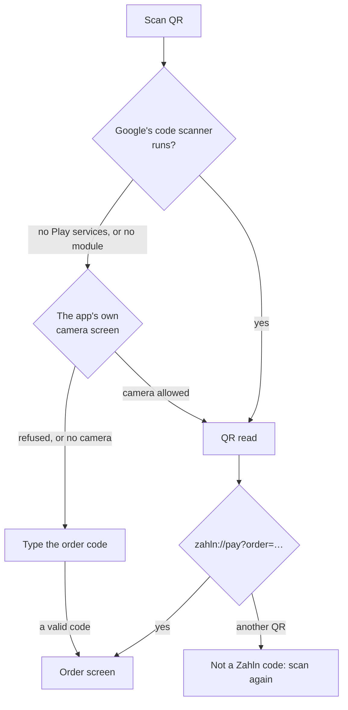

# Student app

What the student app does today, how each part works, and what is still to
build. Progress and commits are in [plan.md](plan.md#step-3-student-app).
Where the API makes something hard, the gap is in [api-gaps.md](api-gaps.md).

The app is for payers: students, staff and guests. It runs on Android phones,
low-end ones included.

## Features

| Feature            | What the payer sees                                                                                                                         | How it works                                                                                                                                                                                      |
| ------------------ | ------------------------------------------------------------------------------------------------------------------------------------------- | ------------------------------------------------------------------------------------------------------------------------------------------------------------------------------------------------- |
| Welcome and login  | **Continue**, then username and password. One message per failure                                                                           | `POST /sessions`. Only a payer gets in: `student`, `staff` or `guest`                                                                                                                             |
| Staying signed in  | A quick reopen skips the login screen                                                                                                       | The token, its expiry and the payer are saved in `localStorage` (`zahln.student.session.v1`) and restored before the first render. Never the password                                             |
| Payment history    | Home lists the payer's payments, newest first: mensa, amount, date, status, items and any refund                                            | `GET /payments`, 20 at a time with **Load more**. Fetched when Home opens, when the app comes back to the front and with **Refresh**. No polling: a payment can stay pending for days             |
| Payment detail     | Amount, mensa and till, items and total, the refunds, and the history from start to now                                                     | `GET /payments/{id}` at `/payments/:paymentId`. The list's copy shows at once while the rest loads. Focus moves to the heading, and Back returns to the same place in the list                    |
| Scan QR            | A **Scan QR** button fixed to the bottom of Home                                                                                            | Google's code scanner first, then two fallbacks ([below](#scanning))                                                                                                                              |
| Scanned order      | The mensa, the till, the items and the price for the payer's group, with "Pay within 4:32"                                                  | `GET /orders/{id}` at `/orders/:orderId`. The countdown runs on the server's clock. At 0 it shows "Time's up. Checking the order…" and asks every 3 seconds until the server says expired or paid |
| Order outcomes     | "Payment being checked", "Already paid", "Order expired" or "Order not found", with **See the payment** when the payment is the payer's own | The server tells the payer the payment id only for their own payment, so that link is the app's way to say "yours"                                                                                |
| Languages          | English or German, from the device                                                                                                          | i18next. Amounts and times through `Intl`, times on Berlin's clock, the mensas' own time zone                                                                                                     |
| Touch and TalkBack | Buttons and fields at least 48 px tall. Statuses as a solid badge with an icon and a word                                                   | Results and errors are announced. The countdown is a timer region, so TalkBack doesn't read every second                                                                                          |

## Scanning

A phone that can't scan must still get the payer to their order, and typing
the long code is the last resort.

- **Google's code scanner** needs no camera permission and is light on a
  low-end phone. Its module is installed on first use, with a 60 s limit.
- **The app's own camera screen** asks for the camera, and shows "Point the
  camera at the QR code on the till's screen". A QR that isn't the till's gets
  a hint, and scanning carries on.
- **Typing** is offered only when no scanner can run, or the camera is
  refused. The till prints the code under its QR. Spaces are ignored, and the
  QR's whole text can be pasted ([API gap 8](api-gaps.md#8-no-short-order-code)).

## How it is built

| Layer   | Where                                                             | What it holds                                                                                                                                |
| ------- | ----------------------------------------------------------------- | -------------------------------------------------------------------------------------------------------------------------------------------- |
| Screens | `apps/student/src/screens/`                                       | Each part as `Foo.tsx` (data and handlers) and `FooJSX.tsx` (markup only)                                                                    |
| Data    | `apps/student/src/data/`                                          | TanStack Query hooks: `useSession`, `useLogin`, `usePayments`, `usePayment`, `usePayerOrder`, and the scan steps. Screens never call the API |
| Routes  | `apps/student/src/app/`                                           | `/`, `/login`, `/home`, `/payments/:paymentId`, `/orders/:orderId` and `/scan`, behind the same signed-in and signed-out guards as the till  |
| Native  | `packages/native`                                                 | Google's code scanner and the camera scanner, behind small tested wrappers                                                                   |
| Shared  | `packages/api`, `packages/domain`, `packages/ui`, `packages/i18n` | The client, the shapes, the components and the strings, shared with the till                                                                 |

The rules every screen follows:

- **Late answers never win.** A payment or an order with a lower `version`
  than one shown is dropped, in the list and the detail alike. A detail older
  than the list's copy is read again, up to 3 times, 1 second apart: the one
  retry TanStack Query makes on its own.
- **Only the server says "expired" or "paid".** The countdown reaching 0 never
  shows a result.
- **Anything new from the server still shows.** A history event the app
  doesn't know reads as "Other change", and an unknown attention reason is
  accepted as it is, instead of failing the whole payment.
- **A refused token logs out.** The app keeps no password to log in again
  with ([API gap 2](api-gaps.md#2-no-refresh-token)).

## Still to build

- **Paying.** Biometrics, or the device PIN without them, then
  `POST /orders/{id}/payments` with the amount shown. The key is saved on the
  device before the first send, so a killed app picks the payment up again.
  One message for each answer: pending, declined, a changed price, expired,
  already paid, an update needed, payments switched off.
- **`GET /config`** at start and before paying: a forced update, and payments
  switched off.
- **Picking student, staff or guest** before login.
- **Renewing the token,** as on the till.
