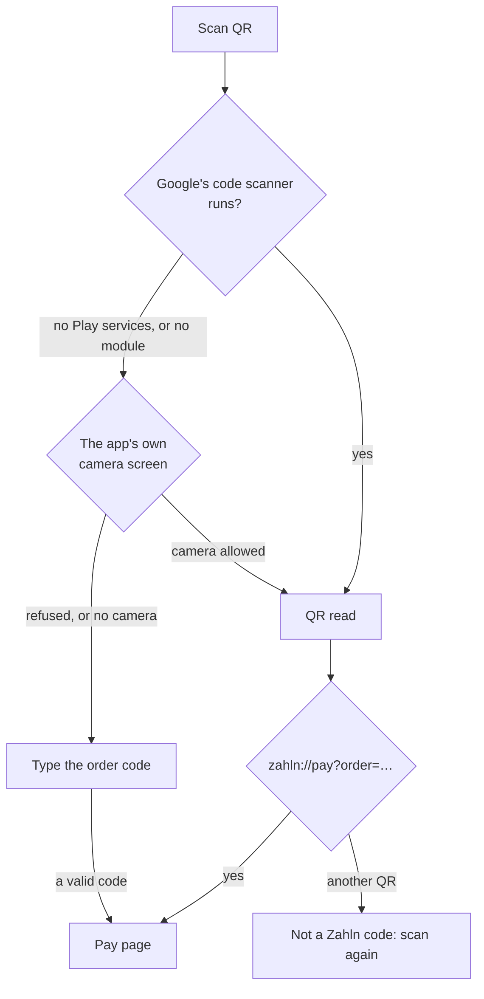
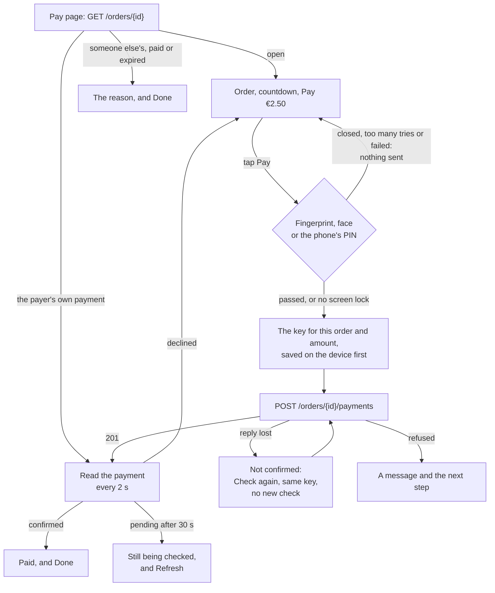

# Student app

What the student app does today, how each part works, and what is still to
build. Progress and commits are in [plan.md](plan.md#step-3-student-app).
Where the API makes something hard, the gap is in [api-gaps.md](api-gaps.md).

The app is for payers: students, staff and guests. It runs on Android phones,
low-end ones included.

## Features

| Feature             | What the payer sees                                                                                                                   | How it works                                                                                                                                                                          |
| ------------------- | ------------------------------------------------------------------------------------------------------------------------------------- | ------------------------------------------------------------------------------------------------------------------------------------------------------------------------------------- |
| Welcome and login   | **Continue**, then username and password. One message per failure                                                                     | `POST /sessions`. Only a payer gets in: `student`, `staff` or `guest`                                                                                                                 |
| Staying signed in   | A quick reopen skips the login screen                                                                                                 | The token, its expiry and the payer are saved in `localStorage` (`zahln.student.session.v1`) and restored before the first render. Never the password                                 |
| Payment history     | Home lists the payer's payments, newest first: mensa, amount, date, status, items and any refund                                      | `GET /payments`, 20 at a time with **Load more**. Fetched when Home opens, when the app comes back to the front and with **Refresh**. No polling: a payment can stay pending for days |
| Payment detail      | Amount, mensa and till, items and total, the refunds, and the history from start to now                                               | `GET /payments/{id}` at `/payments/:paymentId`. The list's copy shows at once while the rest loads. Focus moves to the heading, and Back returns to the same place in the list        |
| Scan QR             | A **Scan QR** button fixed to the bottom of Home. A scan opens the Pay page                                                           | Google's code scanner first, then two fallbacks ([below](#scanning))                                                                                                                  |
| Pay page            | The mensa, the till, the items and the price for the payer's group, with "Pay within 4:32" and **Pay €2.50**                          | `GET /orders/{id}` at `/pay/:orderId`. The countdown runs on the server's clock. At 0, Pay turns off and the page asks every 3 seconds until the server says expired or paid          |
| Confirming it's you | Before anything is sent, Android's own dialog asks for a fingerprint, the face or the phone's PIN, and shows the amount and the mensa | `@capgo/capacitor-native-biometric` behind `identityCheck` in `packages/native`. A phone without a screen lock pays without it ([below](#confirming-its-the-payer))                   |
| Paying              | **Confirming…**, **Paying…**, then "Payment being checked", "Paid" or "Payment declined", or a message with the next step             | `POST /orders/{id}/payments` with one idempotency key per order and amount, saved before the first send. The payment is then read every 2 seconds for 30 seconds ([below](#paying))   |
| Order page          | The same order details, read only, with no Pay                                                                                        | `/orders/:orderId`. Nothing links to it yet                                                                                                                                           |
| Languages           | English or German, from the device                                                                                                    | i18next. Amounts and times through `Intl`, times on Berlin's clock, the mensas' own time zone                                                                                         |
| Touch and TalkBack  | Buttons and fields at least 48 px tall. Statuses as a solid badge with an icon and a word                                             | Results and errors are announced. The countdown is a timer region, so TalkBack doesn't read every second. Focus moves to each payment result as it comes in                           |

## Scanning

A phone that can't scan must still get the payer to their order, and typing
the long code is the last resort.

- **Google's code scanner** needs no camera permission and is light on a
  low-end phone. Its module is installed on first use, with a 60 s limit.
- **The app's own camera screen** asks for the camera, and shows "Point the
  camera at the QR code on the till's screen". A QR that isn't the till's gets
  a hint, and scanning carries on.
- **Typing** is offered only when no scanner can run, or the camera is
  refused. The till prints the code under its QR. Spaces are ignored, and the
  QR's whole text can be pasted ([API gap 8](api-gaps.md#8-no-short-order-code)).

## Paying

Everything about paying happens on the Pay page, and every state there has a
next step. **Back** and **Done** go to Home in place of the Pay page, so Back
never returns to an order that is already paid. Before anything is sent,
the phone checks that its owner is paying
([below](#confirming-its-the-payer)).

### What the Pay page shows

| State                                    | The page                                                                       | Buttons                                    |
| ---------------------------------------- | ------------------------------------------------------------------------------ | ------------------------------------------ |
| Loading                                  | Grey blocks, and "Loading the order…" for TalkBack                             | **Pay**, disabled                          |
| The order couldn't be loaded             | "The order couldn't be loaded"                                                 | **Try again**                              |
| No such order                            | "Order not found"                                                              | **Done**                                   |
| Open                                     | Countdown, amount at the payer's price, mensa and till, items                  | **Pay €2.50**                              |
| Time up                                  | "Time's up. Checking the order…"                                               | **Pay**, disabled                          |
| Confirming                               | The order as before, under Android's fingerprint, face or PIN dialog           | **Confirming…**, disabled                  |
| Paying                                   | The order as before                                                            | **Paying…**, disabled                      |
| Being checked                            | "Payment being checked" and the payment: amount, place, time, items            | **Done**, **See the payment**              |
| Still being checked                      | "Still being checked. This can take a few minutes"                             | **Done**, **Refresh**, **See the payment** |
| Paid                                     | "Paid" and the payment                                                         | **Done**, **See the payment**              |
| Someone else's payment, paid, or expired | "A payment for this order is being checked", "Already paid" or "Order expired" | **Done**                                   |

**Pay** and the buttons under a payment sit in a bar fixed to the bottom of
the screen, so they are in reach however long the order is.

### Confirming it's the payer

Before a payment is sent, Android's own dialog asks for a fingerprint, the
face or the phone's PIN. Its title is the amount ("Pay €2.50") and under it
is the mensa, so the payer confirms what the phone shows, not only what the
page said. The plugin and why it was picked are in
[design.md](design.md#technology-choices-and-what-i-would-change-about-yours).

| The phone's answer                                          | The page                                                                                   | Sent    |
| ----------------------------------------------------------- | ------------------------------------------------------------------------------------------ | ------- |
| Passed                                                      | **Paying…**, then as [below](#each-answer-to-pay)                                          | Yes     |
| The phone has no screen lock                                | **Paying…** without asking                                                                 | Yes     |
| The payer closed the dialog: Back, a tap outside, or a call | **Pay** again, with no message. Focus goes back to Pay                                     | Nothing |
| Too many tries                                              | "Too many tries. Nothing was paid. Wait a moment or use your phone's PIN, then pay again." | Nothing |
| The check can't run                                         | "Couldn't confirm it's you. Nothing was paid. Try again."                                  | Nothing |

The decisions behind it:

- **A phone without a screen lock pays without the check.** Whoever holds
  such a phone can already open everything on it, so asking would protect
  nothing. An emulator also has no screen lock by default, and blocking Pay
  there would stop anyone trying the app from paying at all.
- **Only a new payment asks.** **Check again**, and **Pay** after the app
  was closed with the key still saved, resend a payment the payer has
  already confirmed, under the same key, so they don't ask again. A key is
  only made after the check passes. A new key asks: after a decline, a
  changed price, or for another order.
- **Every biometric counts, weak face unlock included.** Android rates some
  face unlock as weak (Class 2), and cheaper phones often have nothing
  stronger. The check only confirms the owner and unlocks no stored secret,
  which is where Android asks for strong biometrics.
- **The check is part of paying, not of the screen.** It runs inside
  `usePayOrder`, before the key is made, so no screen can send a payment
  without it, and a closed dialog leaves no key behind.
- **The server decides expiry.** If the countdown reaches 0 while the dialog
  is open, the payment is still sent. An expired order is refused, and the
  page says "Order expired. Nothing was paid". The app doesn't decide that by
  the phone's clock.

### Each answer to Pay

| Server answer                                                                  | Key                   | The page                                                                                   |
| ------------------------------------------------------------------------------ | --------------------- | ------------------------------------------------------------------------------------------ |
| 201 `pending`                                                                  | Spent                 | "Payment being checked", then reads the payment ([below](#after-a-payment))                |
| 201 `confirmed`                                                                | Spent                 | "Paid"                                                                                     |
| 201 `declined`                                                                 | Spent                 | The order again, with "Payment declined. Nothing was paid" and **Pay**                     |
| 502, 504, no answer or 503 `unavailable`, after 3 tries                        | Kept                  | "Payment not confirmed. It may have gone through" and **Check again**                      |
| 409 `amount_mismatch`                                                          | Spent                 | The order is read again: "The price changed" and **Pay** with the new amount               |
| 409 `order_expired`, `order_already_paid`, `order_payment_in_progress`, or 404 | Spent                 | The order is read again and the page shows why it can't be paid, with **Done**             |
| 426                                                                            | Spent                 | "Update the app" and **Done**                                                              |
| 503 `payments_disabled`                                                        | Kept when `retryable` | "Payments are paused. Try again in a few minutes" and **Pay**                              |
| 401                                                                            | Spent                 | The session ends and the payer logs in again ([API gap 2](api-gaps.md#2-no-refresh-token)) |
| Anything else                                                                  | Spent                 | "The payment didn't go through" and **Pay**                                                |

Each request tries up to 3 times, 10 seconds each, with the same key. Only a
reply that may pass if sent again is tried again.

### The key

- **One key per order and amount,** made when Pay is first tapped and saved
  in `localStorage` (`zahln.student.payIntent.v1`) before the request goes.
  It is kept in memory too, so storage that can't be written still covers the
  retries while the app runs.
- **Kept while the payment may exist** (a lost reply) or a retry may pass
  (the server says `retryable`). Sending it again returns the payment the
  server already has, never a second one.
- **Spent once a payment comes back,** declined or not, or once the server
  clearly refuses. The next Pay is a new intent with a new key: the old one
  would only replay the old answer.
- **A new amount is a new key.** The server refuses one key with two bodies.

### After a payment

| What comes back                       | The page                                                                                             |
| ------------------------------------- | ---------------------------------------------------------------------------------------------------- |
| `pending`                             | Reads `GET /payments/{id}` every 2 seconds. Focus moves to "Payment being checked"                   |
| `confirmed`                           | "Paid". Reading stops. Focus moves to "Paid"                                                         |
| `declined`                            | The order again, with "Payment declined" and **Pay**. Focus goes back to Pay                         |
| Still `pending` after 30 seconds      | "Still being checked". Reading stops, since a check can take minutes. **Refresh** reads it once more |
| The page opens on the payer's payment | The order names the payment, so the page reads it and shows where it stands, as above                |

The payment shown is always the newest copy: the one Pay brought back or the
last read, by `version`. The payment's answer beats an older read of the
order, so an order that still says `open` never offers Pay again while the
payment is being checked. Reads share one cache with the payment detail, so
**See the payment** opens already filled in.

### Edge cases

| Case                                                 | What happens                                                                                                                                                |
| ---------------------------------------------------- | ----------------------------------------------------------------------------------------------------------------------------------------------------------- |
| Pay tapped twice                                     | The button turns off on the first tap, through the dialog and the request. Two sends would carry the same key, so the server would return the first payment |
| The payer closes the fingerprint dialog              | Nothing is sent and no key is made. **Pay** is ready again, with focus on it                                                                                |
| The countdown reaches 0 while the dialog is open     | The payment is still sent, and the server decides. An expired order is refused: "Order expired. Nothing was paid"                                           |
| The reply is lost                                    | "Not confirmed" and **Check again** with the same key. The page never says "nothing was paid" while the payment may exist                                   |
| The app is closed mid-payment                        | The key is already saved. Scanning again shows the payer's payment if the order names it, or Pay sends the same key without asking again                    |
| The payer leaves the Pay page mid-payment            | The request still finishes and the key stays saved. The payment shows in the history once Home reloads it                                                   |
| The price changes after the scan                     | 409, the order is read again, and Pay shows the new amount with a new key                                                                                   |
| The countdown reaches 0                              | Pay turns off. Only the server's answer says expired or paid                                                                                                |
| The order reads expired while the payment is pending | The page shows "Being checked": "nothing was paid" could be untrue while the payment may still go through                                                   |
| A read comes back older than one shown               | It is dropped: a lower `version` never replaces a higher one. Paid is final                                                                                 |
| Someone else is paying or has paid the order         | "A payment for this order is being checked" or "Already paid", and **Done**. The server names a payment only to its payer                                   |
| The session ends mid-payment                         | The payer is sent to log in, and the key is spent. The server refuses a second payment while the first is pending or paid                                   |
| Storage is blocked                                   | The key lives in memory until the app closes                                                                                                                |

## How it is built

| Layer   | Where                                                             | What it holds                                                                                                                                                      |
| ------- | ----------------------------------------------------------------- | ------------------------------------------------------------------------------------------------------------------------------------------------------------------ |
| Screens | `apps/student/src/screens/`                                       | Each part as `Foo.tsx` (data and handlers) and `FooJSX.tsx` (markup only). Parts two screens share are in `apps/student/src/components/`                           |
| Data    | `apps/student/src/data/`                                          | TanStack Query hooks: `useSession`, `useLogin`, `usePayments`, `usePayment`, `usePayerOrder`, `usePayOrder`, and the scan steps. Screens never call the API        |
| Routes  | `apps/student/src/app/`                                           | `/`, `/login`, `/home`, `/payments/:paymentId`, `/pay/:orderId`, `/orders/:orderId` and `/scan`, behind the same signed-in and signed-out guards as the till       |
| Native  | `packages/native`                                                 | Google's code scanner, the camera scanner, and the check that the phone's owner is paying, behind small tested wrappers                                            |
| Shared  | `packages/api`, `packages/domain`, `packages/ui`, `packages/i18n` | The client, the pay key store, the shapes, the components and the strings, shared with the till. Whether an order can still be paid is decided in `domain`, tested |

The rules every screen follows:

- **Money moves once.** A payment goes with one key per order and amount,
  saved before the first send, and every retry reuses it.
- **Nothing is sent without the payer's yes.** The fingerprint, face or PIN
  check is part of the pay call, before the key is made. Only a phone with no
  screen lock skips it.
- **Late answers never win.** A payment or an order with a lower `version`
  than one shown is dropped, in the list and the detail alike. A detail older
  than the list's copy is read again, up to 3 times, 1 second apart: the one
  retry TanStack Query makes on its own.
- **Only the server says "expired" or "paid".** The countdown reaching 0 never
  shows a result, and a payment that may still go through is never shown as
  "nothing was paid".
- **Anything new from the server still shows.** A history event the app
  doesn't know reads as "Other change", and an unknown attention reason is
  accepted as it is, instead of failing the whole payment.
- **A refused token logs out.** The app keeps no password to log in again
  with ([API gap 2](api-gaps.md#2-no-refresh-token)).

## Still to build

- **`GET /config`** at start and before paying, so a forced update or paused
  payments show before the tap instead of in the answer to it.
- **Renewing the token,** so a session that ends mid-payment doesn't send
  the payer to the login screen. The till doesn't renew either.
- **Picking student, staff or guest** before login.
