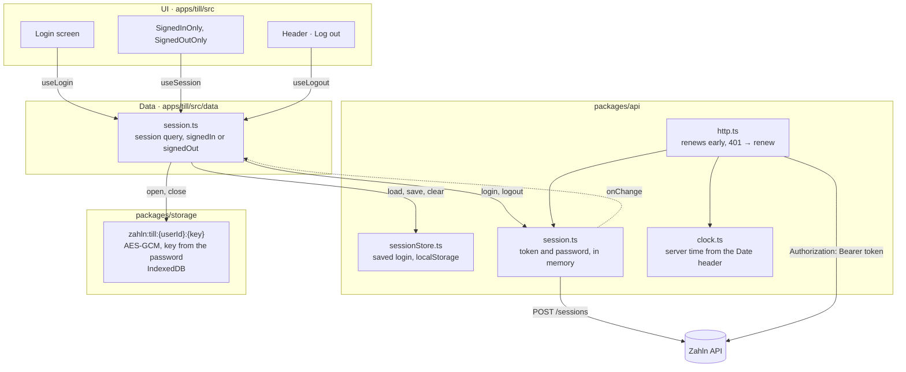
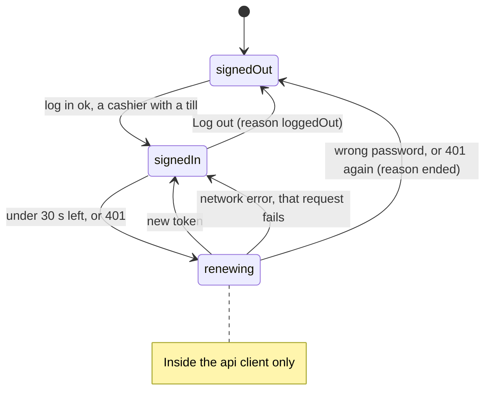
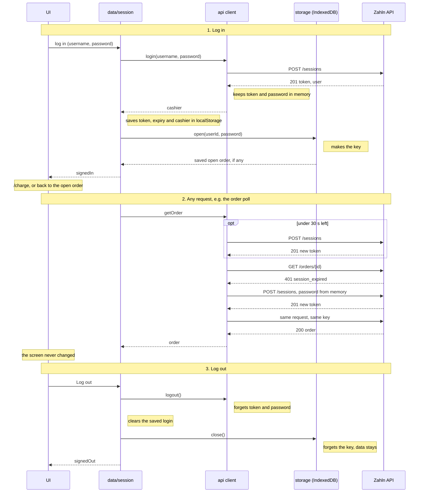

# Till plan

The detailed plan for steps 1 and 2 of [plan.md](plan.md): the till, and the
parts of `domain` and `api` it needs. The student app's parts follow in step 3.
The plan changes as the work does.

## What the till does

- Ring up an order from the mensa's menu and show its QR.
- Show the cashier the result once the student has paid.
- Refund a payment in full or in part, with a clear error when it isn't
  allowed.

## Architecture: three layers

| Layer                 | Folder                                  | What it holds                                                                                                                                                  |
| --------------------- | --------------------------------------- | -------------------------------------------------------------------------------------------------------------------------------------------------------------- |
| UI                    | `apps/till/src/screens/`, `components/` | Screens, each as `Foo.tsx` (container) and `FooJSX.tsx` (JSX only)                                                                                             |
| Store (Redux Toolkit) | `apps/till/src/store/`                  | The till's own state, which the server doesn't have: `cart`, `charge` (the current order's key and id), `refund` (the current refund's key, amount and status) |
| Data access           | `apps/till/src/data/`                   | TanStack Query hooks and the query client's settings                                                                                                           |
|                       | `packages/api`                          | HTTP client: deadlines, retries, keys, session, zod checks, typed errors                                                                                       |
|                       | `packages/storage`                      | Data saved on the device, kept apart and encrypted per cashier                                                                                                 |
| Shared rules          | `packages/domain`                       | zod schemas, money formatting, order and payment state helpers                                                                                                 |

Rules between the layers, enforced by lint where possible:

- Screens read the store and the data hooks. They never import `@zahln/api`.
- Only `data/` imports `@zahln/api`.
- The store holds no server data and sends no requests.
- `packages/api`, `packages/storage` and `packages/domain` don't import React.
- Only `packages/storage` uses `localStorage` or `indexedDB`. The one exception
  is `packages/api/src/sessionStore.ts`, which saves the login (see
  [Staying signed in after a reopen](#staying-signed-in-after-a-reopen)).

### Query client settings

| Setting                                       | Value                                      | Why                                                                           |
| --------------------------------------------- | ------------------------------------------ | ----------------------------------------------------------------------------- |
| `retry`                                       | `false`                                    | Our client is the only one that retries, so retries don't multiply            |
| `networkMode`                                 | `"always"`                                 | The WebView's offline flag is unreliable. Our client handles failures         |
| `structuralSharing` on order and payment data | Keeps the old data when `version` is lower | The server can return an older state, and "paid" must never go back to "open" |
| Mutations                                     | `retry: false`, and the key is passed in   | A mutation never makes up its own key and never retries                       |

## Session and login

The session lives in the data layer, not in the store.

| Part                                     | Owner                                                                                                                | Why                                                                                                                                                    |
| ---------------------------------------- | -------------------------------------------------------------------------------------------------------------------- | ------------------------------------------------------------------------------------------------------------------------------------------------------ |
| Token and password                       | `packages/api` client, in memory. The token is also saved on the device ([below](#staying-signed-in-after-a-reopen)) | The server can end a token before `expiresAt`, so only a `401` says it's gone. The client then logs in again and resends, in the middle of the request |
| The logged-in cashier: name, till, mensa | TanStack Query, key `["session"]`                                                                                    | Screens read it like any other data. It comes from the client, not the network, so a refetch never sends a login                                       |

### Parts



| Part                               | Job                                                                                                                                            |
| ---------------------------------- | ---------------------------------------------------------------------------------------------------------------------------------------------- |
| `packages/api/src/session.ts`      | Holds the token, its expiry and the password in a closure. `login`, `getToken` (renews early), `renew` (one at a time), `logout`, `onChange`   |
| `packages/api/src/http.ts`         | Headers, a deadline per attempt, retries on network errors. On `401` it calls `renew` and resends once with the same key                       |
| `packages/api/src/clock.ts`        | Server time from the `Date` header, so a wrong tablet clock can't cause early or late renewals                                                 |
| `packages/api/src/errors.ts`       | problem+json as an `ApiError` with a typed `code`. A lost response has its own case                                                            |
| `packages/api/src/sessionStore.ts` | `createSessionStore`: `load`, `save` and `clear` of a login in `localStorage`, checked with the app's zod schema. The student app uses it too  |
| `apps/till/src/data/session.ts`    | `useSession`, `useLogin`, `useLogout`. Makes the till's saved-login store. Opens the cashier's saved data after login and closes it at log out |
| `apps/till/src/app/signedInOnly`   | Wraps the till's screens. No session: go to `/login`                                                                                           |
| `apps/till/src/app/signedOutOnly`  | Wraps `/` and `/login`. Signed in: go to the till                                                                                              |

The guards are layout routes, not route loaders. A loader runs only on
navigation, and the session changes without one: at login, at Log out, and on
a refused token. The guards read `useSession`, so they redirect on every change.

### States

```ts
type SessionState =
  | { status: "signedIn"; cashier: Cashier } // name, tillId, mensaId
  | { status: "signedOut"; reason: "start" | "loggedOut" | "ended" };
```



`renewing` exists only inside the client. Screens see `signedIn` or
`signedOut`, so the cashier never notices a renewal. `ended` makes the login
screen say "Your session ended. Log in again."

### Logging in

- The form sends `POST /sessions`. Network errors are retried up to 3 times,
  since a login moves no money.
- zod checks the response, and the account must be a `cashier` with a till.

| Answer                        | The till shows                        |
| ----------------------------- | ------------------------------------- |
| `invalid_credentials`         | "Wrong username or password"          |
| Not a cashier                 | "This account can't use the till"     |
| 502 / 503 / 504 / no response | "Can't reach the server. Try again."  |
| `unknown_candidate`           | "This build has a wrong candidate ID" |

The form has labelled fields with `autocomplete="username"` and
`autocomplete="current-password"`. While sending, the button reads
"Logging in…". Errors appear in an alert that TalkBack announces.

### Keeping the session alive

The API has no refresh token, so renewing means logging in again with the
password kept in memory. The cashier never sees a login screen for it.

| Situation                               | What happens                                                                                                                                                                                    |
| --------------------------------------- | ----------------------------------------------------------------------------------------------------------------------------------------------------------------------------------------------- |
| Under 30 s left, in server time         | Log in again before sending                                                                                                                                                                     |
| `401 session_expired` or `unauthorized` | Log in again, then resend once with the same key                                                                                                                                                |
| Several requests get `401` at once      | One login, shared by all of them                                                                                                                                                                |
| The resend gets `401` again             | Session ended                                                                                                                                                                                   |
| Renewal: wrong password                 | Session ended: the login screen with "Your session ended"                                                                                                                                       |
| Renewal: network error                  | Session kept. That request shows "Connection problem, checking…", and the next poll tries again                                                                                                 |
| App restarted                           | The saved login comes back if its token hasn't run out. Otherwise log in again. The password is never saved                                                                                     |
| Log out                                 | Forget the token and password, clear the saved login, close the saved data, clear the cache and the cart. The server accepts the token until it expires ([API gap 3](api-gaps.md#3-no-log-out)) |

### Step by step



### Staying signed in after a reopen

A till shouldn't ask for the password every time the app is reopened. The
login is saved on the device and comes back at startup until its token runs
out.

| Part           | Choice                                                                                                                                                     |
| -------------- | ---------------------------------------------------------------------------------------------------------------------------------------------------------- |
| What is saved  | `CashierSession`: the token, its expiry and the cashier (name, till, mensa). Never the password                                                            |
| Where          | `localStorage`, key `zahln.till.session.v1`, through `createSessionStore` in `packages/api/src/sessionStore.ts`. A later shape gets a new key              |
| Restored       | Once, when `session.ts` loads, before the first render, so the login screen never flashes                                                                  |
| Checked        | zod (`CashierSessionSchema`), and the expiry against the device clock. There is no server time yet at startup, and a wrong clock costs one refused request |
| Dropped        | A login that is over or doesn't match the schema is removed from storage, not just ignored                                                                 |
| Saved, cleared | `setCashierSession` is the one place the login changes. Login saves it. Log out and a refused token clear it                                               |
| Failures       | Storage that can't be read or written counts as no saved login: one more login, never a crash                                                              |
| No margin      | A token with seconds left still comes back. The first refused request then sends the cashier to the login screen                                           |

- It isn't in `packages/storage`, because that package's key comes from the
  password, which isn't known at startup. The token lasting only 5 minutes
  limits what a copied one is worth.
- With a 5-minute token and no renewal yet, this mostly helps a quick reopen.
  Renewing the token is what will keep a cashier signed in for a shift.

**Known gap: Android backup.** `AndroidManifest.xml` still has
`android:allowBackup="true"`. Auto Backup can then copy the WebView's
`localStorage`, saved token included, to the device account's Google Drive and
restore it on another device. The fix, not done yet: `allowBackup="false"`,
plus `dataExtractionRules` that leave everything out of both `cloud-backup` and
`device-transfer`. From Android 12, `allowBackup="false"` alone doesn't stop a
device-to-device transfer.

## Saved data on the device

Each cashier's data is kept apart and encrypted with a key made from their
password. A prefix alone keeps users apart in our code, but anyone with the
device's files could read every prefix.

| Part       | Choice                                                                                                                                                       |
| ---------- | ------------------------------------------------------------------------------------------------------------------------------------------------------------ |
| Package    | `packages/storage`, shared, because the student app needs it for its payment key                                                                             |
| Where      | IndexedDB, through `idb-keyval`                                                                                                                              |
| Namespace  | `zahln:till:{userId}:{key}`, using the server's user id                                                                                                      |
| Encryption | AES-GCM through WebCrypto. The key comes from the password with PBKDF2 and a random salt per user                                                            |
| The key    | Made at login, kept in memory only, can't be exported, forgotten at log out                                                                                  |
| Reading    | zod checks every value. Data that can't be decrypted or doesn't match reads as empty, never a crash                                                          |
| Access     | Only `packages/storage` may use `localStorage` or `indexedDB`, except the saved login in `packages/api/src/sessionStore.ts`. A lint rule blocks it elsewhere |

`openUserStorage({ app, userId, password })` returns
`{ get(key, schema), set(key, value), remove(key), close() }`.

| Data                                     | Saved?                                                                                                           |
| ---------------------------------------- | ---------------------------------------------------------------------------------------------------------------- |
| Token, its expiry and the cashier        | Yes, outside this package: in `localStorage` until the token runs out ([why](#staying-signed-in-after-a-reopen)) |
| Password, encryption key                 | Never                                                                                                            |
| Open order: key and order id             | Yes                                                                                                              |
| Refund in progress: key, payment, amount | Yes, until the outcome is known                                                                                  |
| Menu                                     | Yes. Put into the cache at login, then refreshed from the server                                                 |
| Payments and their details               | No. They hold payer names, which are personal data, and the till is online anyway                                |

- The server stores idempotency keys per user, so only the cashier who started
  an order or refund may resend it. Encryption makes that automatic, because
  no other cashier can open it. See
  [API gap 4](api-gaps.md#4-no-way-to-look-up-an-unknown-refund).
- Log out and a session end leave the saved data on the device for that
  cashier's next login.

## Screens

| Route                  | Shows                                                                                |
| ---------------------- | ------------------------------------------------------------------------------------ |
| `/`                    | "Welcome to Zahln", and **Continue** to the login screen                             |
| `/login`               | Username and password form. `invalid_credentials` shows "Wrong username or password" |
| `/charge`              | The menu and the cart, with the total for student, staff and guest                   |
| `/charge/:orderId`     | QR, countdown and live status                                                        |
| `/payments`            | This till's payments, newest first, paged, searchable by payment or order id         |
| `/payments/:paymentId` | Amount, refunded, refundable, refunds, history, and the refund form                  |

`/` and `/login` are only for someone signed out. A signed-in cashier,
including one whose saved login came back at startup, goes straight to the
till.

A header shows the cashier and the till, links to Charge and Payments, and has
Log out.

## Data hooks

| Hook              | Call                                    | Refetches                                                    |
| ----------------- | --------------------------------------- | ------------------------------------------------------------ |
| `useSession`      | Memory, from the saved login at startup | Never                                                        |
| `useLogin`        | `POST /sessions`                        | Mutation                                                     |
| `useLogout`       | The client, no network                  | Mutation                                                     |
| `useMenu`         | `GET /mensas`, then the cashier's mensa | Once per login, starting from the saved copy                 |
| `useCreateOrder`  | `POST /orders`                          | Mutation                                                     |
| `useOrder`        | `GET /orders/{id}`                      | Every 2 seconds until `paid` or `expired`                    |
| `usePayments`     | `GET /payments`, paged with `cursor`    | On opening the screen, and on Refresh                        |
| `usePayment`      | `GET /payments/{id}`                    | On opening, then every 2 seconds while a refund is `pending` |
| `useCreateRefund` | `POST /payments/{id}/refunds`           | Mutation                                                     |

## Charge flow

1. The cashier adds items to the cart, 1 to 20 of each.
2. **Charge** creates the key in `charge`, then sends `POST /orders`.
3. On success the till opens `/charge/:orderId`. The order's key and id are
   saved in the cashier's storage.
4. The till polls the order until it's `paid` or `expired`.

| Situation                                  | The till shows                                                                                                                   |
| ------------------------------------------ | -------------------------------------------------------------------------------------------------------------------------------- |
| Order being created                        | "Creating order…"                                                                                                                |
| Create failed, outcome unknown             | "Couldn't confirm the order", and **Try again**, which sends the same key                                                        |
| `open`                                     | QR, countdown in server time, "Waiting for the student"                                                                          |
| `paying`                                   | "Payment being checked"                                                                                                          |
| `paying`, then `open` with a newer version | "Payment declined. The student can try again."                                                                                   |
| `paid`                                     | "Paid", with the amount and price group from the payment, and **New order**                                                      |
| Countdown at 0                             | "Time's up, checking…". "Expired" only once the server says `expired`, as a payment may still be checked                         |
| Polling fails                              | The last known state, with "Connection problem, checking…". Never a result                                                       |
| App restarted                              | After login, the till goes back to the saved order and polls it                                                                  |
| New order while one is still open          | A warning that the old QR can be paid until it expires. The till keeps checking the old order and shows a notice if it gets paid |

- Changing the cart after a failed create makes a new order with a new key.
  Nothing is lost: an order moves no money, and its QR was never shown.
- **New order** clears the cart and the saved order id.

## Refund flow

1. On `/payments` the cashier finds the payment, by scrolling or searching.
2. `/payments/:paymentId` shows the amount, refunded, pending refunds,
   refundable, the refunds and the history.
3. **Refund all** fills in the refundable amount. A partial amount must be
   above 0 and at most `refundableAmountCents`. The reason is optional.
4. A confirm dialog: "Refund €4.50?"
5. Confirming creates the key in `refund`, then sends
   `POST /payments/{id}/refunds`. The key, payment and amount are saved in the
   cashier's storage until the outcome is known.
6. The till polls the payment until the refund is `completed` or `failed`.

| Situation                | The till shows                                                                                   |
| ------------------------ | ------------------------------------------------------------------------------------------------ |
| Sending                  | "Sending refund…"                                                                                |
| Outcome unknown          | "Couldn't confirm the refund", the form locked, and **Check again** with the same key and amount |
| `pending`                | "Refund being processed"                                                                         |
| `completed`              | "Refunded €4.50"                                                                                 |
| `failed`                 | "Refund failed". The form opens again, and a new attempt gets a new key                          |
| `refund_exceeds_payment` | The amount is more than can still be refunded                                                    |
| `payment_not_refundable` | The payment isn't confirmed                                                                      |
| `refund_window_closed`   | The payment is older than 30 days                                                                |
| `forbidden`              | The payment was made at another till                                                             |

- **The form stays locked while the outcome is unknown.** Changing the amount
  would make a new key, and both refunds could go through.
- The same applies after a restart: the saved refund comes back as
  **Check again**.

## Layout and access

- Landscape on a tablet. It also works in portrait, because Android 16 ignores
  the orientation lock on tablets.
- Every string in English and German. Amounts and times are formatted with
  `Intl` in the active language.
- Touch targets of at least 48 px. `@zahln/ui/touch.css` gives every button
  and field a minimum height, in the till and the student app.
- Status changes are announced, so TalkBack users hear "Paid".

## Build order

The till is built in 8 pieces, starting with the static screens and the
session. The pieces, their status and their files are in their own document:
[till-pieces.md](till-pieces.md).

## Libraries added

| Library                           | Why                                   |
| --------------------------------- | ------------------------------------- |
| `@tanstack/react-query`           | Server data: caching, polling, paging |
| `@reduxjs/toolkit`, `react-redux` | The till's own state, from piece 6    |
| `react-router`                    | Screens, from piece 1                 |
| `qrcode.react`                    | Draws the QR as SVG                   |
| `idb-keyval`                      | IndexedDB in about 1 KB               |
| `fake-indexeddb`                  | IndexedDB for tests only              |
