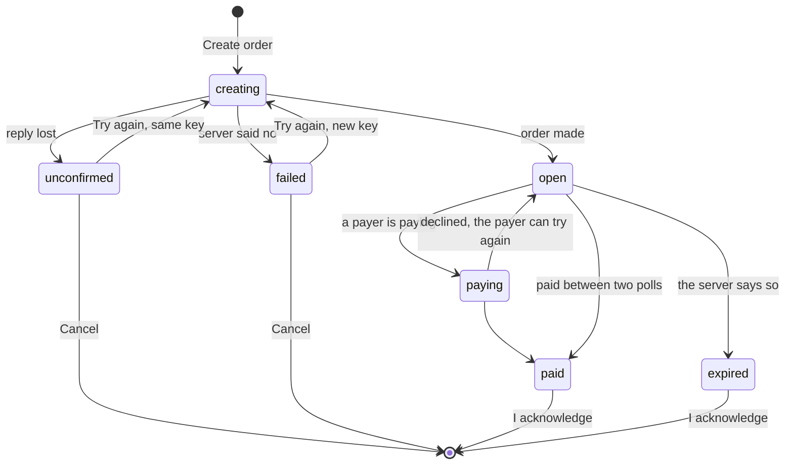

# Till

What the till does today, how each part works, and what is still to build.
Progress and commits are in [plan.md](plan.md#step-2-till). Where the API
makes something hard, the gap is in [api-gaps.md](api-gaps.md).

The till runs on an Android tablet in landscape and also works in portrait,
because Android 16 ignores the orientation lock on tablets.

## Features

| Feature            | What the cashier sees                                                                                                             | How it works                                                                                                                                                                                                                                     |
| ------------------ | --------------------------------------------------------------------------------------------------------------------------------- | ------------------------------------------------------------------------------------------------------------------------------------------------------------------------------------------------------------------------------------------------ |
| Welcome and login  | **Continue**, then username and password. One message per failure: wrong password, not a cashier, no server                       | `POST /sessions`. Only a cashier with a till and a mensa gets in                                                                                                                                                                                 |
| Staying signed in  | A quick reopen skips the login screen                                                                                             | The token, its expiry and the cashier are saved in `localStorage` (`zahln.till.session.v1`) and restored before the first render. Never the password. A login that has run out or doesn't match its schema is dropped                            |
| Log out            | Back to the login screen                                                                                                          | Forgets the token, clears the saved login and every cached answer, so the next cashier sees nothing of the last                                                                                                                                  |
| Mensa tab          | The mensa, its city and the till. The menu with the student, staff and guest price of each dish                                   | `GET /mensas` once per login. Tick a dish to pick it, − and + for 1 to 20 of it                                                                                                                                                                  |
| Create order       | **Create order** at the bottom of the screen, then a dialog                                                                       | `POST /orders` with an `Idempotency-Key`. One key per cart: when the reply is lost, "Couldn't confirm the order" and **Try again** resend the same key while the cart is the same, so the server hands back the order instead of making a second |
| The order's QR     | The QR, the order code under it, and a live status line                                                                           | `GET /orders/{id}` every 2 seconds, also in the background, until `paid` or `expired`. A reply with a lower `version` than one shown is dropped                                                                                                  |
| Payments tab       | This till's payments, newest first: time, order code, amount, refunded, status, payer and items                                   | `GET /payments`, which a cashier gets for their own till only. 20 at a time with **Load more**. Fetched each time the tab opens and with **Refresh**                                                                                             |
| Screens            | The greeting, Log out and the two tabs stay at the top. On the Mensa tab, Create order stays at the bottom, however long the menu | `ScreenLayoutJSX` from `packages/ui`, as in the student app. The Mensa tab draws Create order into the footer with a React portal, so the cart and its key stay in the tab                                                                       |
| Languages          | English or German, from the device                                                                                                | i18next. Amounts and times through `Intl`, times on Berlin's clock                                                                                                                                                                               |
| Touch and TalkBack | Buttons and fields at least 48 px tall. A long press selects no text, except in fields                                            | Every control has a label naming what it acts on, e.g. "Select Currywurst". Status changes are in live regions, so TalkBack reads "Paid" without a focus move                                                                                    |

## The order dialog

The dialog is the one place an order is followed, so it never closes on its
own. Escape and taps outside do nothing.

| State       | The dialog shows                                                                     |
| ----------- | ------------------------------------------------------------------------------------ |
| `open`      | "Scan to Pay", the QR and "Waiting for payment." After a decline, "Payment declined" |
| `paying`    | The QR and "Payment being checked…"                                                  |
| Poll failed | The last known state, plus "Connection problem, checking…". Never a result           |
| `paid`      | "Paid" and **I acknowledge**, which empties the cart                                 |
| `expired`   | "Order expired. Nothing was paid." Only when the server says so                      |

The QR is hidden once the order is settled, so nobody scans one that can't be
paid. The cashier can't end an order early: the API has no cancel call
([API gap 1](api-gaps.md#1-no-way-to-cancel-an-order)).

## How it is built

| Layer   | Where                          | What it holds                                                                                                                       |
| ------- | ------------------------------ | ----------------------------------------------------------------------------------------------------------------------------------- |
| Screens | `apps/till/src/screens/`       | Each part as `Foo.tsx` (data and handlers) and `FooJSX.tsx` (markup only). The cart is the Mensa tab's own state                    |
| Data    | `apps/till/src/data/`          | TanStack Query hooks: `useSession`, `useLogin`, `useMensa`, `useCreateOrder`, `useOrder`, `usePayments`. Screens never call the API |
| Routes  | `apps/till/src/app/`           | `/`, `/login` and `/home`. Layout-route guards send a signed-out cashier to the login screen and a signed-in one to `/home`         |
| Client  | `packages/api`                 | Deadlines, retries, keys, server time, zod checks, typed errors. Shared with the student app                                        |
| Shapes  | `packages/domain`              | zod schemas, split into the server's shape and the app's, and the version checks                                                    |
| UI kit  | `packages/ui`, `packages/i18n` | shadcn components as generated, the status badge, the screen layout, the strings and the money and date formats                     |

The rules every request follows:

- **Retries.** 10 s per attempt and up to 3 attempts, with backoff. Only a
  lost reply or an error the server marks `retryable` is retried, always with
  the same key. TanStack Query doesn't retry on top of that.
- **Late answers never win.** Orders and payments carry a `version`, and a
  lower one never replaces what is shown.
- **Server time.** Taken from each reply's `Date` header, not the tablet's
  clock.
- **A refused token logs out.** The app keeps no password to log in again
  with ([API gap 2](api-gaps.md#2-no-refresh-token)).

## Still to build

- **Refunds,** in full or in part, from a payment's detail. The amount is
  locked while an attempt's outcome is unknown, since a changed amount would
  get a new key and both refunds could go through. One message for each
  refusal: more than can be refunded, not confirmed, older than 30 days,
  another till's payment.
- **Keeping the open order across a restart,** so a cashier who reopens the
  app sees the order a payer may be paying. It needs `packages/storage`: data
  saved per cashier and encrypted with a key made from their password.
- **Renewing the token** with the password kept in memory, so the session
  lasts a shift and a refused token never closes the QR dialog. The student
  app already does this with `createSessionRenewal` from `packages/api`.
- **Turning off Android backup.** `allowBackup="true"` lets Auto Backup copy
  the saved login off the device. The fix is `allowBackup="false"` plus
  `dataExtractionRules`, which Android 12 and later need for device-to-device
  transfer.
- **Search** in the Payments tab, by payment or order id.
